# MyOS

MyOS — учебная операционная система для x86. Загрузчик написан на ассемблере,
ядро и программы — на C. Процессор работает в 32-битном защищённом режиме.
Вместе с ядром собраны библиотека программ, оболочка, рабочий стол, свой стек
TCP/IP, браузер и компилятор Си.

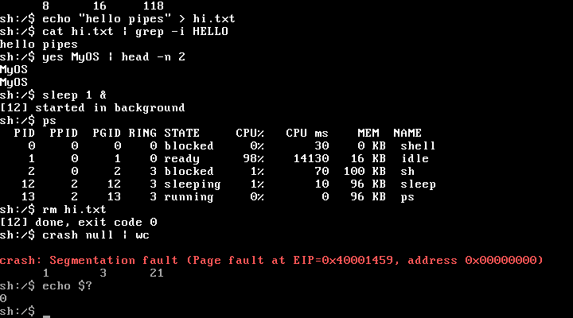

| `mandel` — фрактал на `double` | `paint` — рисование мышью |
|---|---|
| 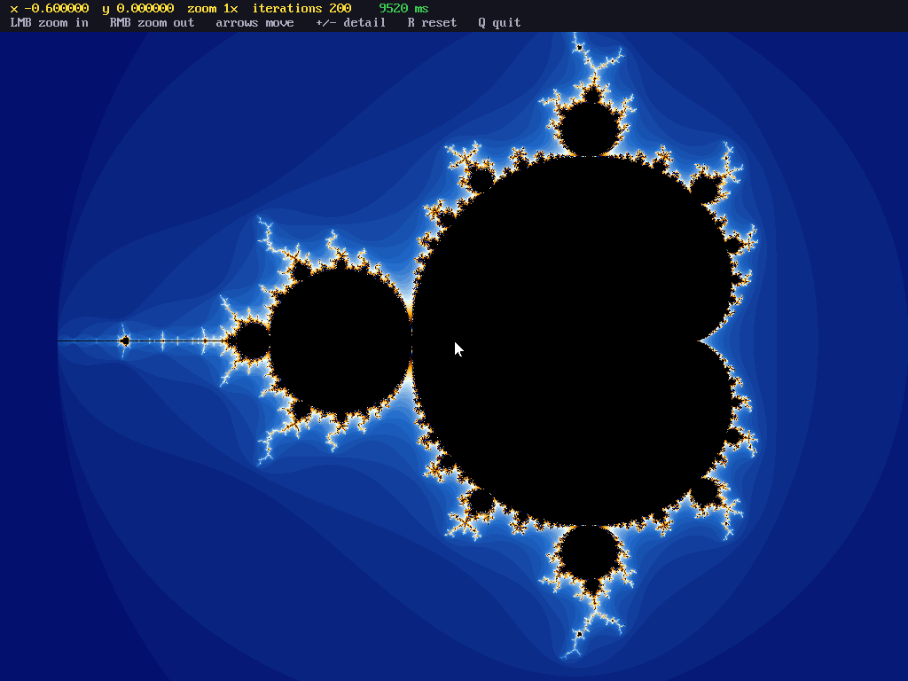 | 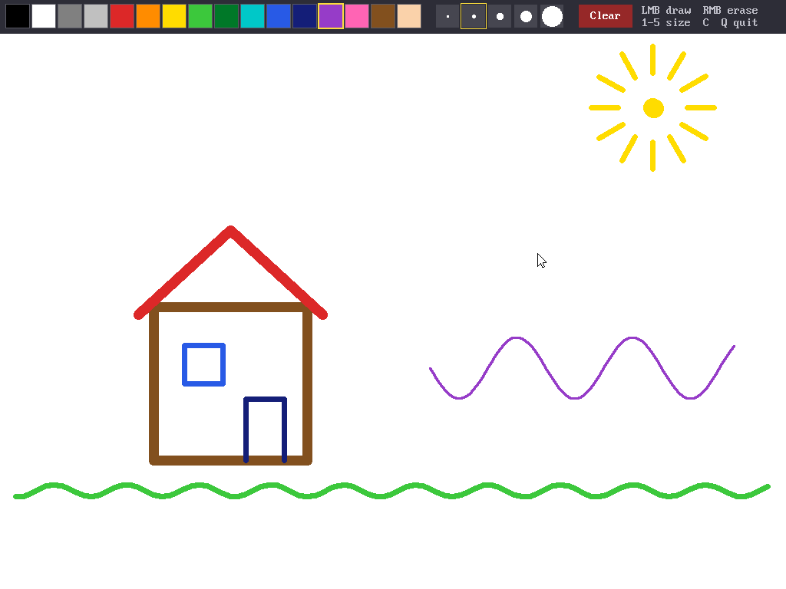 |
| редактор `edit` | игра `snake` |
| 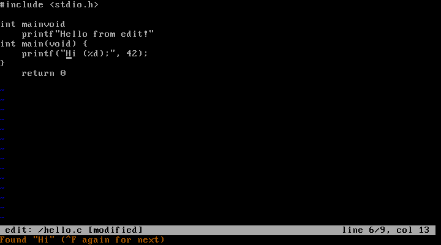 | 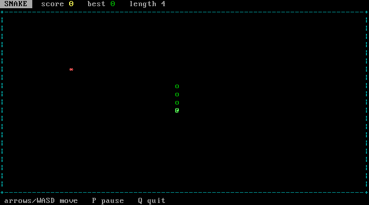 |

## Принципы

Система задумана как одно целое, от первого сектора диска до окна на рабочем столе.

**Свой код на каждом слое.** Загрузчик, ядро, libc, оболочка, рабочий стол,
графика, шрифты, сеть, браузерный TLS, JavaScript и компилятор написаны для MyOS.
Чужая программа ставится отдельно и описана в [docs/ext.md](docs/ext.md).

**Программа живёт в кольце 3.** У процесса своё адресное пространство.
Исключение завершает эту программу, ядро продолжает работать. Оболочка
`/bin/sh` и рабочий стол — обычные программы. Оболочка ядра остаётся запасным
входом: в неё попадают по `exit` из `sh`.

**Процессы устроены как в Unix.** `fork`, `exec`, `waitpid`, каналы, группы,
учётные записи и права файлов. Из кольца 3 в ядро ведёт один шлюз, `int 0x80`.

**Железо делает работу, которую умеет.** Несколько CPU выполняют пользовательский
код параллельно. VirtIO-GPU и VMware SVGA хранят окна и собирают кадр на
видеокарте. Тот же стол рисуется процессором, если карты с ускорением нет:
Bochs VBE в QEMU и VBE на реальном ПК.

**Систему можно менять изнутри.** Исходники лежат в `/src`. Компилятор `cc`
собирает программу и умеет собрать сам себя.

## Система в целом

BIOS читает загрузчик и ядро из `build/os.img`. Файлы живут на отдельном томе
MyFS, `disk.img`. После монтирования диска стартует менеджер служб, затем
интерактивная оболочка спрашивает логин и пароль. Пустой логин означает root.
При первом запуске пароль root задаётся здесь же. Дальше открывается `/bin/sh`.

```
sh:/$ ls /bin | grep s | wc              конвейер из трёх процессов
sh:/$ echo "hello pipes" > hi.txt        вывод в файл (>> — дописать)
sh:/$ cat hi.txt | grep -i HELLO
sh:/$ wc < hi.txt                        ввод из файла
sh:/$ yes MyOS | head -n 2               yes завершится с SIGPIPE, когда head выйдет
sh:/$ sleep 5 &                          в фоне; потом: ps, kill <pid>
sh:/$ yes | grep y | wc                  Ctrl+C завершит весь конвейер
sh:/$ ls /bin/c*                         шаблоны; Tab дополняет команды и имена файлов
sh:/$ edit /notes.txt                    редактор: ^S сохранить, ^Q выйти, ^K/^U, ^F, ^G
sh:/$ snake                              змейка: стрелки/WASD, P пауза, Q выход
sh:/$ top                                процессы, обновление раз в секунду
sh:/$ mandel                             фрактал: ЛКМ приблизить, ПКМ отдалить, стрелки, +/-, Q
sh:/$ paint                              рисование: палитра сверху, 1-5 толщина, C очистить, Q
sh:/$ fputest 20000000 &                 две-три копии печатают один и тот же результат
sh:/$ sh /script.sh                      команды из файла
sh:/$ desktop                            рабочий стол
sh:/$ exit                               в оболочку ядра
```

Команды системы лежат в `/bin`. Установленные порты — в `/ext/bin`; при одинаковом
имени выполняется `/bin`. Как ставить Lua, Python, OpenSSH и остальные порты,
написано в [docs/ext.md](docs/ext.md).

Дальше документ идёт в том порядке, в каком собирается работающая система:
загрузка, память, задачи, процессы и оболочка, файлы, терминал, графика,
сеть и браузер, компилятор, люди и службы, сборка.

## Загрузка

```
BIOS ──> сектор 0 (boot.bin) по адресу 0x7C00, 16-битный реальный режим
           │  INT 13h: читает сектора 1..N  ──> 0x10000
           │  INT 15h E820: карта памяти    ──> 0x8000
           │  A20 ─> GDT ─> CR0.PE=1 ─> far jmp
           ▼
         32-битный защищённый режим ──> _start (entry.asm) ──> kmain() (kernel.c)
```

Загрузчик — 512 байт, `boot/boot.asm`. Он читает ядро через BIOS INT 13h (LBA),
включает линию A20, загружает GDT и переходит в защищённый режим.

| Образ | Роль |
|---|---|
| `build/os.img` | Загрузочный диск IDE, `index=0`. Внутри `[boot.bin][kernel.bin]`. `make` пересобирает его целиком. В `/dev` этот диск не публикуется. |
| `disk.img` | Том MyFS. В QEMU он подключён к AHCI port 0 и виден как `/dev/sdb`. `make` обновляет `/bin`, `/lib`, `/include` и `/src` и не меняет размер тома. |
| `DATA_DISK` | Необязательный второй диск, IDE secondary master, `/dev/sdc`. Пример: `make run DATA_DISK=data.img`. |

Устройства, разделы и точки монтирования — в [docs/storage.md](docs/storage.md).

### Живой USB и загрузка по сети

`make usb-image` собирает отдельный образ `build/myos-usb.img` для BIOS/CSM:
загрузчик через INT 13h, framebuffer VBE, клавиатура и мышь USB HID по xHCI.
Обычный `make run` при этом остаётся прежним. Размер живого корня задаёт
`USB_ROOT_MB` (64–512 МиБ, по умолчанию 256). Для корня 256 МиБ удобно 512 МиБ
RAM, для 512 МиБ — 1 ГиБ. `make usbtest` проверяет загрузку с USB в QEMU.
Файлы живой системы пишутся на загрузочную флешку; журнал, `fsync` и границы
записи — в [docs/persistence.md](docs/persistence.md). Выбор режима VBE, в том
числе на NVIDIA, — в [docs/nvidia.md](docs/nvidia.md). Список PCI, USB и портов
показывают `lspci -v`, `lsusb -t` и `lsports`, описание —
в [docs/hardware-inventory.md](docs/hardware-inventory.md). Подключение
клавиатуры и мыши после загрузки — в [docs/usb-hotplug.md](docs/usb-hotplug.md).
Полный путь реального ПК — в [docs/hardware.md](docs/hardware.md).

`make netboot-image` публикует живой образ, `make netboot-serve` раздаёт его
по HTTP. Маленькая флешка iPXE один раз записывается командой
`make netboot-usb`, дальше обновление приезжает с сервера при перезагрузке.
Настройка — в [docs/netboot.md](docs/netboot.md).

## Память

```
Физическая память                      Виртуальная память (после включения paging)
0x00000000  IVT, BIOS data             0x00000000  НЕ отображена -> NULL = page fault
0x00007C00  загрузчик                  0x00001000 ┐
0x00008000  карта E820                            │ 1:1 (identity), страницы по 4 КБ
0x00010000  ядро (.text .data .bss)               │
0x0009F000  загрузочный стек ядра (16 КБ вниз)    │
0x000B8000  видеопамять VGA            0x003FFFFF ┘
0x00100000  ┐ свободная RAM:           0x00400000 ┐ 1:1, страницы по 4 МБ, только ядро
            │ раздаёт PMM фреймами     0x3FFFFFFF ┘ до 1 ГБ, не дальше
 конец RAM  ┘ по 4 КБ                  0x40000000 ┐ память программы, своя у процесса:
                                       0xBFFFFFFF ┘ код, куча, загрузчик, mmap, стек
                                       0xD0000000 ┐ куча ядра, страницы по мере роста
                                       0xD3FFFFFF ┘ (до 64 МБ)
```

- **PMM** (`kernel/pmm.c`) держит битовую карту, один бит на кадр 4 КБ, и счётчик
  владельцев кадра. Свободным считается только то, что BIOS пометил как `usable`.
  Первый мегабайт не раздаётся. `fork` делит страницы с родителем, а запись
  делает копию.
- **Paging** (`kernel/paging.c`): каталог страниц и таблицы. `vmm_map`,
  `vmm_unmap`, `vmm_translate`. Страница 0 пустая, поэтому разыменование NULL
  видно сразу: экран паники показывает адрес из CR2.
- Память программы начинается с кода по `0x40000000`. Куча через `sbrk` растёт
  до `0x80000000`. Динамический загрузчик (`PT_INTERP`) живёт с `0x80000000`,
  `mmap` — с `0xB0000000` до стека. `mmap` умеет анонимные страницы и
  `MAP_PRIVATE` для файла. `ET_DYN` грузится от выбранной базы. Если в ELF есть
  `PT_INTERP`, ядро загружает этот файл и кладёт на стек auxv (`AT_PHDR`,
  `AT_PHNUM`, `AT_ENTRY`, `AT_BASE`, `AT_PAGESZ`).
- **Куча ядра** (`kernel/heap.c`): блоки с 16-байтными заголовками в двусвязном
  списке, first fit, разрезание и склейка соседних свободных блоков. Двойное
  освобождение и чужой указатель ловятся по magic-числу (`panic double` это
  показывает).

Физическая память аллокатора ограничена первым гигабайтом. Адреса 1–3 ГБ
отданы программам. Таблицы ACPI за этим гигабайтом ядро читает временными
отображениями, на размер кучи это влияет.

```
mem
heaptest 5000
peek 0xB8000 64
peek 0xD0000000
panic pf
```

Объём RAM QEMU задаёт `QEMU_MEM`. По умолчанию и в примере `.env` это 1024M:
карта ядра покрывает 1 ГиБ, больше `make run` не даёт.

## Задачи

Таймер PIT идёт на 100 Гц. От него считаются `uptime` и `sleep`, и он же
вытесняет задачи.

```
  задача A работает ──> IRQ0 (таймер) ──> isr_common кладёт регистры A на стек A
                                             │
                                isr_handler -> sched_tick -> schedule()
                                             │  запоминает esp задачи A,
                                             │  выбирает B, возвращает esp задачи B
                                             ▼
  задача B работает <── iret <── isr_common: mov esp, eax; pop регистров B
```

Переключение контекста сделано в `kernel/isr.asm` и `kernel/task.c`. Обработчик
прерывания возвращает указатель на сохранённые регистры. Если это регистры
другой задачи, `iret` продолжает уже её. Новой задаче заранее собран кадр
«как будто её прервали» в начале `task_entry()`. `task_yield()` — это `int 0x81`.

Состояния: `ready`, `running`, `sleeping` (`sleep_ms`), `blocked` (ждёт событие,
например клавишу или мьютекс), `zombie` (завершилась, стек освободят позже).
Если делать нечего, работает `idle` и выполняет `hlt`.

Куча и экран защищены короткими участками с `cli` (`irq_save` / `irq_restore`).
Файловая система берёт рекурсивный мьютекс, ждущая задача спит. Клавиатура
будит оболочку из прерывания (`task_wakeup`), гонка потерянного пробуждения
закрыта. Исключение в задаче (page fault, деление на ноль) убивает только её.
Переполнение стека ловится красной зоной и канарейкой на дне стека.

Общий предел — 256 задач, включая процессы, потоки и служебные задачи ядра.
Стек ядра у каждой задачи — 16 КБ.

Планировщик — MLFQ, три очереди на каждом CPU. Кванты 10, 20 и 40 мс.
Правила повышения, понижения и переноса задач — в [docs/scheduler.md](docs/scheduler.md).

```
spawn clock          часы в правом верхнем углу
spawn counter        жадный поток; запустите два-три и посмотрите ps
spawn primes 5000000 конечная задача: посчитает и завершится
spawn crash          поток разыменует NULL и завершится только он
spawn deep           бесконечная рекурсия, переполнение стека
ps                   список задач и загрузка CPU за последнюю секунду
kill 3
kill all
```

### Несколько процессоров и потоки программы

Ядро поднимает до 8 логических CPU, в том числе SMT, если прошивка отдала их
в ACPI MADT. Новый процесс назначается на менее загруженный CPU. В примере
`.env` у QEMU четыре CPU (`QEMU_CPUS=4`); `sysinfo` показывает, сколько их
реально запустилось. Пользовательский код выполняется параллельно. Общая
блокировка ядра закрывает файловую систему, сеть, таблицу задач и кучу;
отдельные блокировки уже есть у PMM и журнала. Устройство —
в [docs/smp.md](docs/smp.md) и [docs/kernel-locking.md](docs/kernel-locking.md).

Программа создаёт свои потоки: `thread_create`, `thread_join`, мьютекс и общая
память процесса. Пример на сто потоков — `threads 100`. Контракт вызовов —
в [docs/threads.md](docs/threads.md).

## Процессы

```
myos:/> hello world             программа из /bin: argc/argv, номер процесса, кольцо 3
myos:/> guess                   «угадай число» — ввод с клавиатуры через read()
myos:/> count 10 500 &          в фоне; ps, пока она считает
myos:/> primes 5000000          память через malloc -> sbrk
myos:/> note купить молоко      дописать строку в /notes.txt; note — показать
myos:/> wc /notes.txt           строки, слова, байты (без файла — клавиатура до Ctrl+D)
myos:/> crash null|kernel|code|cli|io|stack|div|syscall|loop
```

`crash` читает NULL, лезет в память ядра, пишет в свой код, выполняет `cli`
или `out`, переполняет стек и подсовывает ядру указатель на его память.
Каждый раз завершается только программа (`Segmentation fault`). `crash loop`
останавливается по Ctrl+C.

```
Адресное пространство процесса           Каталог страниц процесса
0x00000000 ┐                              записи 0..255    ┐ общие с ядром,
           │ ядро: RAM 1:1 (до 1 ГБ)      записи 832..847  ┘ без бита USER
0x40000000 ┤ .text .rodata  (R-X)         записи 256..767  — свои у каждого
           │ .data .bss     (RW-)                            процесса
           │ куча (sbrk) ↓
           │ ...
0xBFF00000 │ стек программы 1 МиБ ↑
0xC0000000 ┤ argc, argv на вершине стека
0xD0000000 ┘ куча ядра
```

В GDT добавлены сегменты кольца 3 (`0x1B`, `0x23`) и TSS (`kernel/gdt.c`).
Из TSS процессор берёт стек ядра (`esp0`), когда в программе случается
прерывание. При переключении задач планировщик пишет туда стек ядра следующего
процесса и загружает его `CR3`.

Загрузчик ELF (`kernel/process.c`) раскладывает сегменты `PT_LOAD` по новым
страницам. Код без права записи, данные с правом записи. На вершину стека
кладутся строки аргументов, `argv[]` и `argc`. Первый `iret` с `cs = 0x1B`
переводит процессор в кольцо 3.

Системные вызовы (`kernel/syscall.c`) идут через `int 0x80`: номер в `eax`,
аргументы в `ebx`, `ecx`, `edx`. Это единственный шлюз IDT с DPL 3.

| № | вызов | | № | вызов |
|---|-------|-|---|-------|
| 0 | `exit(code)` | | 5 | `sbrk(inc)` |
| 1 | `write(fd, buf, len)` | | 6 | `sleep(ms)` |
| 2 | `read(fd, buf, len)` | | 7 | `getpid()` |
| 3 | `open(path, mode)` | | 8 | `ticks()` |
| 4 | `close(fd)` | | 9 | `yield()` |

Ядро проверяет каждый указатель от программы: он лежит в её памяти (1–3 ГБ),
и страница отображена с битом USER (и WRITE, если ядро будет туда писать).
Иначе вызов возвращает `-EFAULT`.

Если процесс убивают (Ctrl+C, `kill`), пока он внутри системного вызова, ядро
доводит текущую операцию до выхода из ядра и только тогда завершает процесс.
Файловая система не остаётся на половине записи. Коды выхода как в Unix:
`137` — убит (`128+9`), `139` — segmentation fault (`128+11`).

`kill` от программы разрешён себе, процессам того же UID и root. Общая память
по умолчанию закрыта даже для root, пока создатель не выдал доступ. Страницы
стека закрыты сторожевыми страницами. Подробности —
в [docs/isolation.md](docs/isolation.md).

### fork, exec и каналы

Так `sh` выполняет `ls /bin | wc`:

```
sh ──pipe()──> [fd 3: чтение | fd 4: запись]  (канал: буфер 4 КБ в ядре)
 │
 ├─fork()─> потомок 1: dup2(4, 1)   stdout -> канал;  exec("/bin/ls")
 ├─fork()─> потомок 2: dup2(3, 0)   stdin  <- канал;  exec("/bin/wc")
 │          (оба в одной группе процессов: Ctrl+C завершит обоих)
 ├─close(3), close(4)               иначе wc никогда не увидит конец канала
 └─waitpid(ls), waitpid(wc)
```

`fork` (`kernel/process.c`, `vmm_clone_user`) делит страницы с родителем и
копирует страницу при записи. Открытые файлы наследуются. Потомок получает
копию кадра системного вызова с `eax = 0`, поэтому из того же `fork()` он
возвращается с нулём.

`exec` загружает новую программу в новое адресное пространство, переключает
`CR3`, освобождает старое и подменяет кадр системного вызова: `iret` уходит
в начало новой программы. Открытые файлы остаются, на этом построены
перенаправления.

Открытые файлы (`kernel/file.c`) — объекты со счётчиком ссылок. После
`fork` и `dup2` несколько дескрипторов указывают на один объект. Канал
закрывается, когда исчезает последняя ссылка на его конец. Читатель видит
конец файла, когда писателей не осталось. Писатель без читателей получает
`EPIPE` и завершается с кодом 141, как SIGPIPE.

Код выхода ребёнка хранится, пока родитель не вызовет `waitpid`. Если родитель
завершился раньше, ребёнок становится сиротой, и ядро убирает его само.
`sh` ставит процессы конвейера в одну группу и говорит ядру (`setfg`), какая
группа сейчас на экране. Ctrl+C завершает её целиком и не трогает саму `sh`.

Системные вызовы 10–24: `fork`, `exec`, `waitpid`, `pipe`, `dup2`, `chdir`,
`getcwd`, `readdir`, `kill`, `setpgid`, `setfg`, `mkdir`, `unlink`, `ps`,
`getppid`. Ошибки — `-errno`, как в Linux. `strerror()` есть в libc.

Рабочий стол запускает окно через `spawn`, а не через `fork`+`exec`: так
графические буферы стола не копируются в потомка при первой же записи.
`fork` и `exec` при этом остаются. Устройство —
в [docs/process-launch.md](docs/process-launch.md).

Утилиты в `/bin`: `sh`, `ls`, `cat`, `echo`, `grep`, `head`, `wc`, `ps`,
`top`, `htop`, `kill`, `mkdir`, `rm`, `sleep`, `yes`, `tar`, `gzip`, `ar`,
`clear`, `edit`, `snake`, а также `hello`, `guess`, `count`, `primes`, `note`,
`crash`. `htop` — свой монитор под статистику ядра, клавиши —
в [docs/htop.md](docs/htop.md). `tar` распаковывает `.tar` и `.tar.gz`.

## Оболочка

`/bin/sh` — программа кольца 3. В ней конвейеры `|`, перенаправления `>` `>>` `<`,
фон `&`, кавычки, `$?`, шаблоны `*` и `?`, история (↑↓) и дополнение по Tab.
Пока набирается строка, оболочка в сыром режиме терминала: рисует строку сама
(←→, Home/End, Ctrl+U/K/W/L), листает историю, дополняет команды из `/bin` и
`/ext/bin` и имена файлов. Второй Tab показывает варианты.

Оболочка ядра (`kernel/shell.c`, приглашение `myos:/>`) работает в кольце 0.
Сюда попадают по `exit` из `sh`.

```
myos:/> mkdir docs
myos:/> echo Hello from MyFS! > docs/hello.txt
myos:/> echo second line >> docs/hello.txt
myos:/> cd docs
myos:/docs> cat hello.txt
Hello from MyFS!
second line
myos:/docs> edit notes.txt        # построчный редактор, '.' — сохранить и выйти
myos:/docs> cp hello.txt ../copy.txt
myos:/docs> cd ..
myos:/> tree
myos:/> df
```

Команды оболочки ядра: `help`, `clear`, `echo`, `about`, `uptime`, `color`,
`history`, `sleep`, `panic`, `reboot`, `halt`; файловые `ls`, `tree`, `cd`,
`pwd`, `mkdir`, `touch`, `cat`, `write`, `edit`, `cp`, `mv`, `rm`, `df`,
`format`; память `mem`, `heaptest`, `peek`, `panic pf`; задачи `ps`, `spawn`,
`kill`, `run`. Неизвестное имя ищется в `/bin`, затем в `/ext/bin`.

Свою программу можно написать уже внутри системы:

```
sh:/$ edit hi.c
sh:/$ cc hi.c
sh:/$ ./hi Daniil
Hi, Daniil!
```

Тот же файл можно положить в дерево исходников на компьютере, `user/myprog.c`,
и `make run` соберёт все `user/*.c` в `/bin`. Заголовки программ —
`user/lib/myos.h`. Как устроен `cc`, написано ниже.

## Файловая система

MyFS хранит каталоги, имена до 255 символов и символические ссылки.
Том — до 64 ГиБ, до 2 097 152 inode. Один файл версии 2 адресует около 1 ГиБ:
к прямой, косвенной и двойной косвенной картам добавляется тройная. `format` пишет версию 5;
монтирование принимает тома с версии 1. Журнал, проверка после аварии, `fsync`, `umount`
и `/etc/fstab` — в [docs/persistence.md](docs/persistence.md). Несколько дисков
и разделы MBR — в [docs/storage.md](docs/storage.md).

Блок равен сектору, 512 байт.

```
блок 0        суперблок: magic "MYFS", размеры и смещения областей
блоки 1..B    битовая карта: 1 бит на блок (0 — свободен)
следующие I   таблица inode: от 256 до 2 097 152 штук по 64 байта
дальше        блоки данных
```

Inode хранит тип (файл, каталог или символическая ссылка), размер и карту
блоков. Версия раскладки 1 — 12 прямых ссылок, одна косвенная и одна двойная
косвенная, файл до примерно 8 МиБ. Версия 2 отдаёт последнюю прямую ссылку
тройному косвенному блоку (128³ указателей, около 1 ГиБ вместе с остальной картой).
Текст цели ссылки лежит в теле файла. Поиск пути раскрывает ссылки (не больше
40). Удаление и переименование действуют на саму ссылку.

Каталог — обычный файл. Версия 1 хранит записи по 32 байта
`{номер inode, имя до 27 символов}`. Версия 2, которую пишут `format` и `mkfs`,
хранит запись переменной длины, кратную 4 байтам: номер inode, длина записи,
длина имени и само имя до 255 символов. Путь в ядре — до 1023 символов.
Уже записанный том версии 1 монтируется как был; `myfs grow` переписывает его
в версию 2. В каждом каталоге есть `.` и `..`. Корень — inode 1.

На диске без MBR с нулевым первым сектором ядро создаёт MyFS. Неизвестная или
повреждённая файловая система сама не форматируется. `format yes` пересоздаёт
корневую MyFS. `mkfs DEVICE --yes` форматирует выбранный неподключённый том.

Число inode считается при форматировании: один inode на 32 сектора, не меньше
256 и не больше 2 097 152. Новый `disk.img` создаётся размером `DISK_MB`.
Встроенное значение — 4096, то есть 4 ГиБ, разреженный файл. Готовый образ
`make` не увеличивает.

Утилита `build/myfs` собрана из того же кода, что ядро, и работает с образом
на компьютере: `build/myfs disk.img ls /bin`, `build/myfs disk.img put file.txt /file.txt`.

Закройте QEMU и расширьте сырой диск с сохранением файлов:

```bash
build/myfs disk.img grow 65536
```

Число — новый размер в мегабайтах, от 1 до 65536. `grow` читает дерево
каталогов, записывает его в новый пустой образ и перед заменой сверяет каждый
файл. Прежний `disk.img` остаётся рядом как `disk.img.bak`. Если места под
текущие файлы не хватает, команда останавливается и старый образ не трогает.
Диск с таблицей разделов так не увеличить: нужен новый том и копирование,
как в [docs/storage.md](docs/storage.md).

`make cleandisk` удаляет `disk.img`. Следующий запуск создаёт пустую файловую
систему размером `DISK_MB`.

Владелец, группа, биты `rwx`, sticky-bit и `umask` проверяются в ядре.
Команды `chmod`, `chown`, `stat` и `ls -l` — в [docs/permissions.md](docs/permissions.md).

## Терминал

Консоль понимает подмножество escape-последовательностей VT100/xterm
(`kernel/vga.c`):

| последовательность | что делает |
|---|---|
| `ESC[r;cH` | курсор в строку r, столбец c (с 1) |
| `ESC[A` `B` `C` `D` | курсор вверх / вниз / вправо / влево |
| `ESC[2J`, `ESC[J`, `ESC[K` | очистить экран / до конца экрана / до конца строки |
| `ESC[0m` `1m` `7m` `31m`…`37m` `41m`…`47m` `90m`…`97m` | сброс, яркость, инверсия, цвета текста и фона |
| `ESC[?25l` / `ESC[?25h` | спрятать / показать курсор |

Режим терминала программа задаёт вызовом `ttymode` (№ 25):

- обычный: ядро само собирает строку с эхом и Backspace, программа получает её по Enter;
- `TTY_RAW`: каждая клавиша приходит сразу и без эха; стрелки, Home/End, PgUp/PgDn и Delete приходят как `ESC[A`, `ESC[H`, `ESC[5~`…, а Ctrl+буква — кодами 1–26;
- `TTY_NONBLOCK`: `read` не ждёт клавишу;
- `TTY_NOSIG`: Ctrl+C приходит программе как код 3 и не завершает её, поэтому `edit` не теряет несохранённый текст.

Режим принадлежит включившему его процессу. Если тот завершится, ядро само
вернёт терминал в обычное состояние.

Псевдотерминал (`kernel/tty.c`, вызов `pty_open`, № 54) — пара «ведущий —
ведомый». Ведомую сторону программа получает как stdin/stdout/stderr, и для
неё это та же консоль: строка с эхом, `ttymode`, `termsize`, `setfg` и Ctrl+C
работают с её терминалом. Ведущая сторона у окна Terminal: туда окно пишет
клавиши байтами, оттуда читает вывод и рисует его само. Размер задаёт окно:
`ttyctl(fd, TTYCTL_SETSIZE, cols << 16 | rows)` (№ 55).

```
клавиши --write(master)--> [строка, эхо, ^C] --> in  --read(slave)-->  sh, edit, top
экран   <--read(master)--  out <-------------------------write(slave)--
```

Раскладку переключает ядро (Alt+Shift или Win+Space; узнать или сменить —
`kblayout`, № 56). Буквы идут программам в UTF-8. `readkey()` собирает их
обратно в кодовую точку Unicode (`'й'` = 0x439), так их получают и окна
(`EV_KEY`). `sh`, Блокнот, адресная строка, поля браузера и поиск в обзоре
ходят и стирают целыми буквами. Шрифт текстовой консоли ядра кириллицы не
содержит, там эхо рисуется как `?`. В libc есть `readkey()` (последовательности
разбираются в `KEY_UP`, `KEY_PGDN`…), `gotoxy()` и константы `ANSI_*`.

Клавиатура PS/2 отдаёт Shift, Caps Lock, стрелки и раскладку ЙЦУКЕН.
Колесо мыши и прокрутка терминала — в [docs/mouse-wheel.md](docs/mouse-wheel.md).

На этих режимах сделаны полноэкранные `edit`, `snake` и `top`. Окно Terminal
на рабочем столе — тот же псевдотерминал, и эти программы работают внутри него.

## Графика

```
 PCI: устройство класса 3 (видеокарта) ──> BAR0 = физический адрес видеопамяти (0xFD000000)
 порты 0x1CE/0x1CF (Bochs VBE): ширина 1024, высота 768, 32 бита, включить LFB
 видеопамять отображается в ядро на 0xE0000000:  пиксель (x,y) = *(u32*)(0xE0000000 + (y*1024 + x)*4)
```

Перед переключением в графику ядро читает шрифт 8×16 из плоскости 2
видеопамяти и дальше рисует им консоль. Экран по-прежнему хранится как сетка
символов (код и цвет), а изменённая клетка рисуется пикселями. ANSI-цвета,
курсор и прокрутка те же. Терминал становится 128×48, и `sh`, `edit`, `snake`,
`top` подстраиваются под его размер.

Программа рисует в своём буфере и отдаёт кадр ядру вызовом `gfx_blit`, целиком
или только изменившимся прямоугольником. Пока экран захвачен (`gfx_acquire`),
консоль печатает в сетку символов. Когда программа выходит, падает или её
завершают по Ctrl+C, ядро перерисовывает консоль.

Мышь (`kernel/mouse.c`): IRQ12, пакеты по 3 или 4 байта, координаты считает ядро.
При каждом переключении задач ядро сохраняет FPU (`fnsave` / `frstor`), поэтому
программам доступны `float` и `double`. `fork` копирует регистры FPU, `exec`
даёт чистые. `printf` понимает `%f`.

Системные вызовы 27–32: `gfx_info`, `gfx_acquire`, `gfx_blit`, `mouse`,
`gfx_font`, `termsize`. Библиотека `user/lib/gfx.h`: `gfx_open`, `gfx_close`,
`gfx_flip`, `gfx_flip_rect`, `gfx_pixel`, `gfx_line`, `gfx_thick_line`,
`gfx_rect`, `gfx_fill_rect`, `gfx_circle`, `gfx_fill_circle`, `gfx_text`,
`gfx_text_scaled`, `mouse_get`, курсор `gfx_cursor_draw` / `gfx_cursor_erase`.

```c
#include "gfx.h"
int main(void) {
    if (gfx_open() < 0) return 1;
    gfx_clear(RGB(0, 0, 60));
    gfx_fill_circle(512, 384, 100, C_YELLOW);
    gfx_text_scaled(380, 520, "Hello, MyOS!", C_WHITE, 3);
    gfx_flip();
    while (readkey() < 0) sleep_ms(20);
    gfx_close();
    return 0;
}
```

В окне QEMU мышь захватывается щелчком, **Ctrl+Alt+G** возвращает её хозяину.
Если видеокарта не отдала линейный framebuffer, MyOS остаётся в текстовом
режиме 80×25.

### Контуры и шрифты

Растеризатор (`user/lib/vec.c`) и движок TrueType (`user/lib/font.c`) считают
на целых числах, поэтому их собирает и `cc` внутри MyOS.

Линии и кривые Безье режутся на короткие отрезки в фиксированной точке
(1/256 пикселя). Каждая строка пикселей проходится 16 раз. На подстроке ищутся
пересечения с отрезками, и по правилу ненулевой обмотки копится доля покрытия
пикселя с точностью 1/256 по горизонтали. Цвет смешивается с фоном в этой
пропорции.

Фигуры: `gfx_round_rect`, `gfx_ellipse`, `gfx_line16`, `gfx_gradient`,
`gfx_fill_rect_a`, `gfx_shadow`, произвольные контуры `path_*`, рисование
на прозрачном `gfx_canvas_*`. Обрезка `gfx_set_clip` позволяет столу собирать
кадр только в изменившихся местах.

Файл `.ttf` читается целиком. Из `cmap` берётся глиф, из `loca` и `glyf` —
контуры, в том числе составные вроде «й», из `hmtx` — ширины, из `kern` —
пары вроде «AV». Контур кладётся в кэш по шрифту, размеру, глифу и сдвигу
на четверть пикселя. Масштаб по вертикали подогнан так, чтобы высота строчной
«x» была целым числом пикселей.

Шрифты лежат в `/lib/fonts` (каталог `fonts/` репозитория): Ubuntu
Regular, Medium, Bold и Ubuntu Mono, урезанные до латиницы, кириллицы и знаков.
Лицензия — Ubuntu Font Licence, `fonts/UFL.txt`.
`text_draw(FONT_UI, 15, x, y, "Привет", цвет)`. `gfx_text` рисует сглаженным
Ubuntu Mono в тех же клетках 8×16 и понимает UTF-8. Псевдографика CP437
по-прежнему берётся из растрового шрифта видеокарты.

Проверка на компьютере, без QEMU: `make gfxtest` рисует `build/gfxtest.ppm`.
`tests/desktop_host.c` запускает сам рабочий стол на Linux с заглушками
системных вызовов и AddressSanitizer.

### Рабочий стол

```
sh:/$ desktop
```

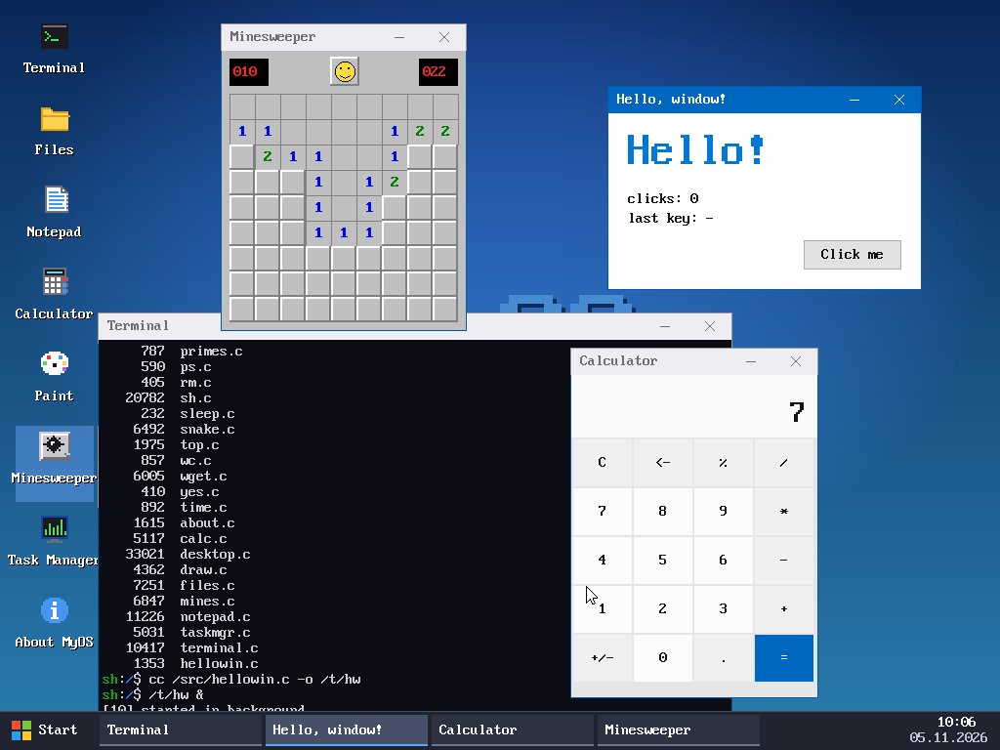

| Все программы | Браузер |
|---|---|
| 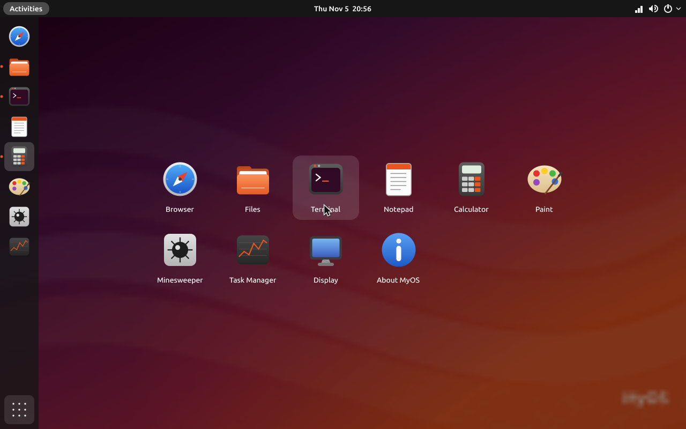 | 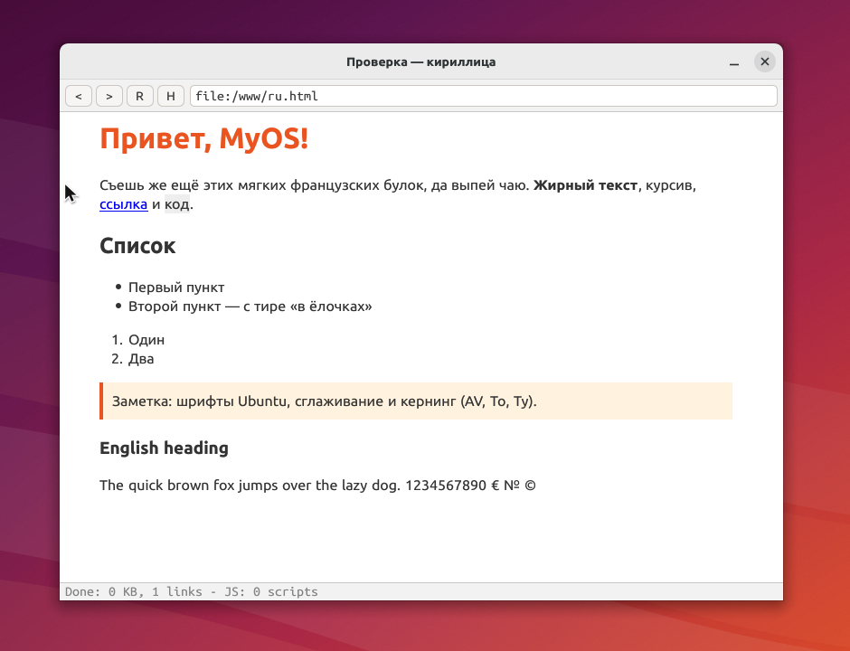 |
| Поиск в обзоре | Terminal и `top` |
| 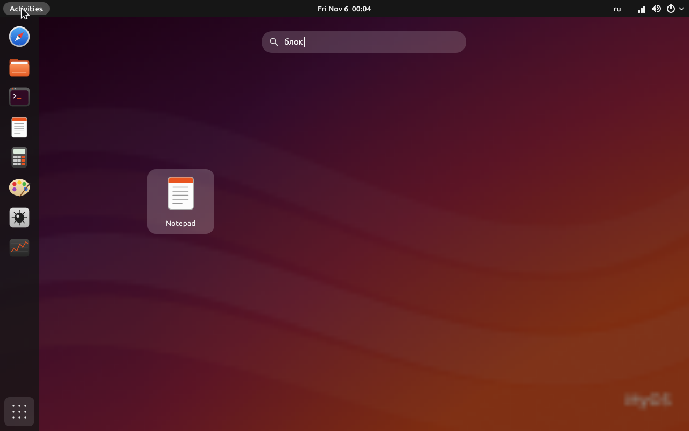 | 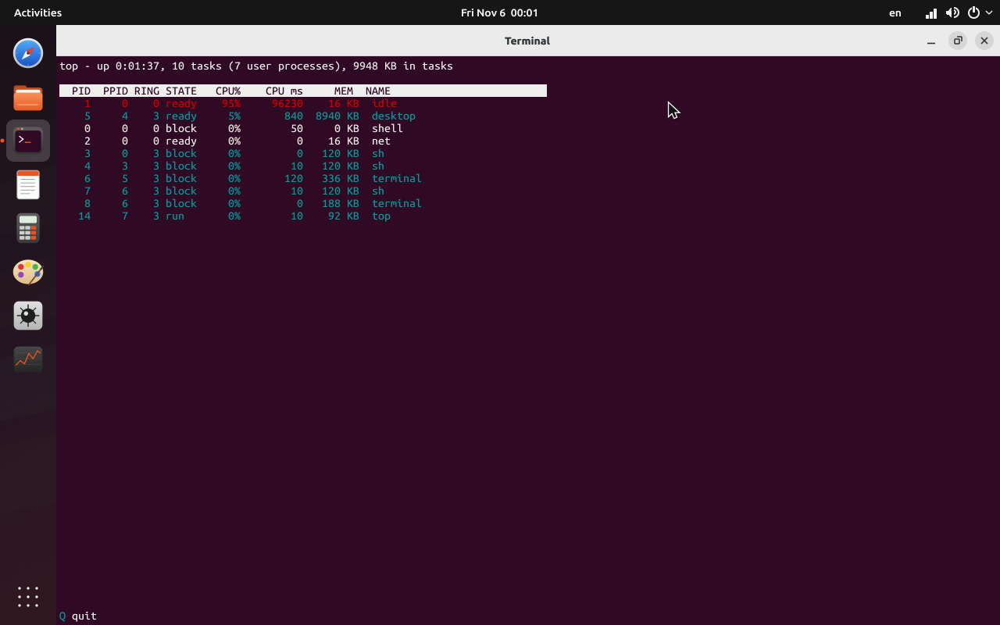 |

`desktop` — обычная программа, сервер окон. Она забирает экран, рисует обои,
окна, панель и курсор и переносит на экран изменившиеся прямоугольники.
Пиксели окна лежат в общей памяти: программа рисует туда, стол читает оттуда.
Команды («создай окно», «обнови прямоугольник») и события (клавиши, мышь,
«закрыть») идут сообщениями. Стол находят по имени службы `desktop`.
Для этого в ядре есть `shm_alloc` / `shm_map` / `shm_unmap`, `msg_send` /
`msg_recv`, `service` и часы `time` (CMOS RTC).

Верхняя панель: «Activities», дата и часы, значки сети, звука и питания.
Щелчок по ним открывает системное меню: экран, «About MyOS», выключение
и выход в консоль. Индикатор раскладки «en» / «ru» переключается щелчком.

Док слева запускает программу или поднимает уже открытое окно. Оранжевые
точки — число окон. Окна программ, запущенных из терминала, тоже попадают
в док.

Обзор (сетка внизу дока или «Activities») показывает все программы поверх
размытых обоев. Набранный текст ищет по названию и словам, в том числе
по-русски. Стрелки выбирают, Enter запускает, Esc стирает поиск или закрывает
обзор. Записи программ читаются из `/usr/share/applications`, формат —
в [docs/apps.md](docs/apps.md).

Окно в духе темы Yaru: заголовок, круглые кнопки свернуть и закрыть,
скруглённые углы, тень у активного окна сильнее. Размер меняется за край
или угол, кнопкой «развернуть», двойным щелчком по заголовку или
перетаскиванием к верхнему краю.

Terminal — это `sh` на псевдотерминале. Files открывает папку, запускает
программу или текст в Notepad. Рядом Calculator, Paint, Minesweeper,
Battleship, Task Manager, About и Display. Панель `settings` меняет DNS,
обои и открывает экран: [docs/settings.md](docs/settings.md). Редактор `code`
с деревом папки и сборкой через `cc` — в [docs/code-editor.md](docs/code-editor.md).
Общий текстовый буфер до 64 КиБ — в [docs/clipboard.md](docs/clipboard.md).

`mandel` и `paint` рисуют на весь экран сами, их запускают вне стола.

Своё окно — тот же `gfx`, только в буфер окна. Образец лежит в `/src/hellowin.c`.

```c
#include "win.h"
int main(void) {
    window *w = win_create("Hello", 300, 150);
    if (!w) return 1;
    gfx_clear(C_WHITE);
    gfx_text(20, 20, "Hello, window!", C_BLACK, TRANSPARENT);
    win_update(w);
    struct event e;
    while (win_event(&e, -1)) {
        if (e.type == EV_CLOSE) break;
        if (e.type == EV_MOUSE_DOWN) {
            gfx_fill_circle(e.x, e.y, 5, C_RED);
            win_update(w);
        }
    }
    return 0;
}
```

В терминале на рабочем столе: `cc /my.c -o /my` и `/my &`. Чтобы окно
растягивалось, вызовите `win_set_resizable` и обработайте `EV_RESIZE`:
в `e.x` и `e.y` новый размер, буфер уже новый, старое содержимое скопировано
в угол. Пока программа не ответила, стол рисует рамку нового размера.

Исходники оконных программ лежат в `/src` и пересобираются внутри MyOS.

### Видеокарта

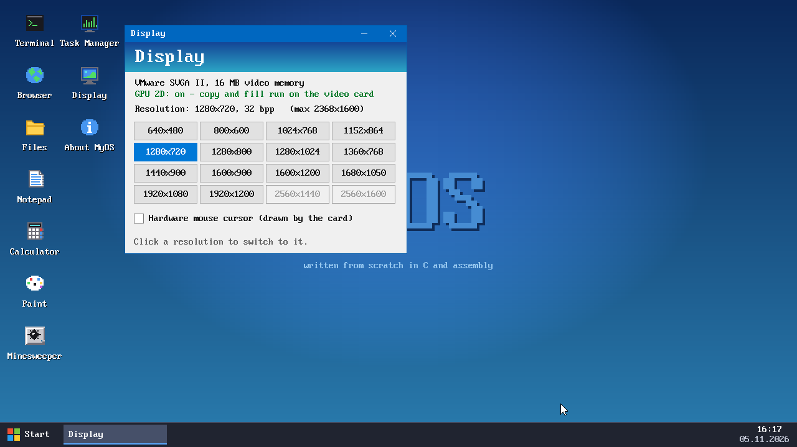

```
sh:/$ mode
Adapter:    VMware SVGA II, 16384 KB video memory
Resolution: 1280x720, 32 bpp, 5120 bytes per line
GPU 2D:     on (rect copy and fill on the card)
HW cursor:  off
Modes:      640x480 800x600 1024x768 1152x864 [1280x720] 1280x800 ... 1920x1200
sh:/$ mode 1920x1080
sh:/$ mode cursor hw
```

Разрешение меняется на лету, от 640×480 и выше, пока хватает видеопамяти.
Выбор запоминается в `/etc/display`. Программа Display на столе делает то же.

`make run` само выбирает видеопуть. На Linux и в WSL с настоящим GPU это
VirtIO-GPU / VirGL: окна лежат в текстурах, прозрачные рамки и тени смешиваются
на карте, кадр переключается из скрытого буфера. Шрифты, контуры и содержимое
окон по-прежнему считает процессор. `GPU=on` требует ускорение, `GPU=off`
оставляет программный путь. В WSLg программный llvmpipe ускорением не считается.
Подробности — в [docs/gpu.md](docs/gpu.md).

`make run VGA=vmware` включает VMware SVGA II (`-vga vmware`): очередь команд
в памяти, аппаратное копирование прямоугольников, заливка и аппаратный курсор.
Эту карту понимают QEMU, VirtualBox (VMSVGA) и VMware. `VGA=std` — Bochs VBE,
тогда пиксели рисует процессор, аппаратного курсора нет, разрешение всё равно
меняется.

Карта SVGA находится по PCI (15ad:0405). У неё три окна: порты регистров,
видеопамять и FIFO. Ядро дописывает команды в конец и сдвигает `NEXT_CMD`.

- `UPDATE x,y,w,h` говорит карте, какой прямоугольник изменился. Консоль копит
  изменения и отправляет их из таймера сто раз в секунду, программы — сразу
  после `gfx_flip`.
- `RECT_COPY` двигает пиксели на карте: прокрутка консоли — одна команда.
  Когда окно тащат, стол просит карту сдвинуть его (`gfx_hw_copy`) и дорисовывает
  открывшуюся полоску.
- `RECT_FILL` в SVGA QEMU объявляет и не выполняет. Процессор заливает одну
  строку, карта копирует её вниз, удваивая: 1, 2, 4, 8… строк.
- `DEFINE_CURSOR` загружает картинку стрелки. Дальше обработчик мыши пишет
  координаты в регистры. Если карта умеет альфа-курсор (`SVGA_CAP_ALPHA_CURSOR`:
  VMware, VirtualBox), стрелка с мягким краем. QEMU умеет только маску
  «есть / нет».
- Перед тем как процессор сам пишет в видеопамять, ядро ждёт `SYNC`, иначе
  запоздавшее копирование затрёт свежие пиксели.
- QEMU применяет новый размер экрана при перерисовке своего окна и до этого
  отбрасывает копирования. После смены режима ядро ставит метку в углу и просит
  скопировать её на соседний пиксель. Пока проверка не сошлась, копирует
  процессор.

Для программ: `gfx_info2`, `gfx_set_mode`, `gfx_check_mode`, `gfx_hw_copy`,
`gfx_hw_fill`, `gfx_hw_cursor`, `gfx_modes`. В ядре — `gfx_mode`, `gfx_info2`,
`gfx_accel`, `gfx_cursor`.

## Сеть

QEMU ставит перед MyOS маршрутизатор с NAT (`-nic user,model=e1000`).
По DHCP система получает адрес **10.0.2.15**, шлюз **10.0.2.2** (это компьютер,
на котором запущен QEMU) и DNS **10.0.2.3**.

```
sh:/$ ifconfig
eth0  Intel e1000   MAC 52:54:00:12:34:56
      inet 10.0.2.15  mask 255.255.255.0  (DHCP, lease 86400 s)
      gateway 10.0.2.2  dns 10.0.2.3
sh:/$ ping 10.0.2.2
sh:/$ host example.com
sh:/$ wget http://example.com/
sh:/$ wget -O - http://example.com/ | head -n 5
sh:/$ httpd &
```

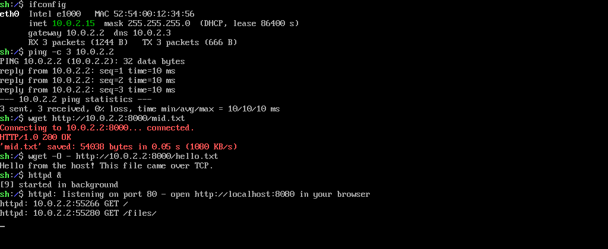

После `httpd &` страница системы открывается на компьютере по порту `HOST_PORT`
из `.env` (в примере это 8081): QEMU пробрасывает его на порт 80 MyOS. На
странице процессы и сеть, обновление каждые 3 секунды, и `/files/` — обзор
диска. Остановить сервер: `ps`, затем `kill <pid>`.

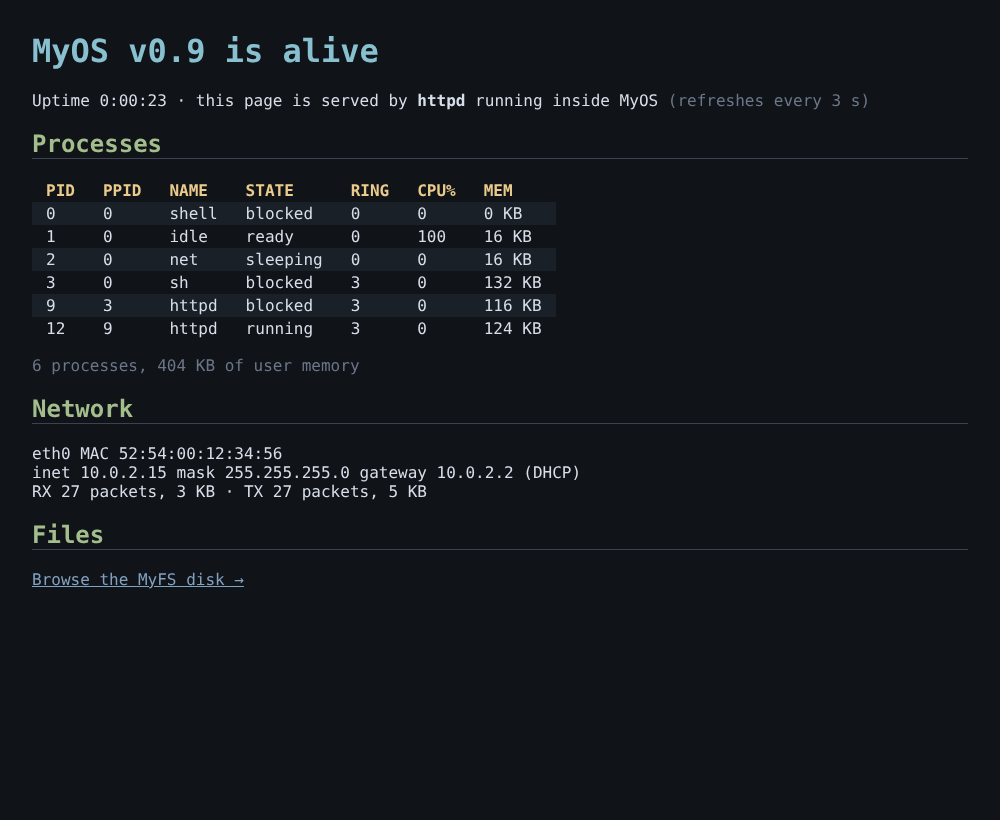

`ping` до внешнего адреса через NAT QEMU обычно не проходит. `ping 10.0.2.2`
и `ping 127.0.0.1` работают. DNS меняется командой `ifconfig dns 1.1.1.1`
и из панели настроек.

`kernel/e1000.c` принимает кадры в кольцо DMA. Поток ядра `net` забирает их.
`kernel/net.c` — Ethernet, ARP, IPv4, ICMP, UDP, DHCP. `kernel/tcp.c` — номера
байтов, подтверждения, окно и повторная отправка. `kernel/socket.c` отдаёт
сокеты программам: `read`, `write` и `close` работают как с файлами. Вызовы:
`socket`, `connect`, `bind`, `listen`, `accept`, `sendto`, `recvfrom`,
`netinfo`, `ping`, `netconfig`. DNS-клиент `resolve` живёт в libc и помнит
32 имени. Окно приёма TCP — 32 КБ.

`sockctl(fd, SOCK_RCVTIMEO, мс)` заставляет `read` вернуть `-ETIMEDOUT`, если
данных нет дольше срока. `SOCK_CONNTIMEO` делает то же для `connect`,
`SOCK_NREAD` сообщает, сколько байт уже пришло. Так браузер ждёт сеть и
обрабатывает свои события.

```c
#include "myos.h"
int main(void) {
    int fd = tcp_connect("example.com", 80);
    if (fd < 0) { printf("error: %s\n", strerror(-fd)); return 1; }
    dprintf(fd, "GET / HTTP/1.0\r\nHost: example.com\r\n\r\n");
    char buf[512]; int n;
    while ((n = read(fd, buf, sizeof(buf))) > 0) write(STDOUT, buf, n);
    close(fd);
    return 0;
}
```

На реальном ПК тот же стек сидит на нескольких контроллерах Intel, не только
на QEMU `e1000`. Список и порядок включения — в [docs/ethernet.md](docs/ethernet.md).

### HTTPS в браузере

Браузер ходит по HTTPS своим стеком в `user/lib/tls.c`, без OpenSSL.
`wget` и `download` устроены иначе: запрос идёт через libcurl и OpenSSL,
это описано в [docs/libcurl.md](docs/libcurl.md).

| Что | Зачем |
|---|---|
| X25519 (RFC 7748) | общий секрет: каждая сторона присылает свой открытый ключ |
| SHA-256, HMAC, HKDF | из секрета и хеша сообщений выводятся ключи |
| ChaCha20-Poly1305 (RFC 8439) | шифр записей на процессоре без AES-инструкций |
| AES-128-GCM | второй шифр, если сервер не предлагает ChaCha20 |
| P-256 (ECDH) | обмен ключами после HelloRetryRequest, если сервер без X25519 |
| RSA, RSA-PSS, ECDSA P-256/P-384, SHA-384/512 | подписи сертификатов и CertificateVerify |
| ASN.1 DER, X.509 | кто выдал, кому, сроки, ключ, subjectAltName |

Рукопожатие (RFC 8446): ClientHello несёт ключ X25519 и имя сайта (SNI).
ServerHello присылает ключ сервера, дальше записи зашифрованы. Сервер
присылает сертификат и Finished. Finished проверяется, значит сообщения по
пути не подменили. Ответный Finished открывает данные. Случайные числа
собираются из `rdtsc`, времени и pid и перемешиваются SHA-256.

Проверка сертификата (`user/lib/x509.c`):

1. Подпись CertificateVerify: сервер подписал хеш рукопожатия ключом из своего сертификата.
2. Имя: `subjectAltName` (в `*.example.com` звёздочка — ровно одна метка) или CN.
3. Цепочка вверх. Издатель ищется среди корневых центров в `/etc/certs.der`, затем среди присланных сертификатов. Проверяются подпись (RSA PKCS#1 v1.5 с SHA-256/384/512 или ECDSA P-256/P-384), сроки и `basicConstraints` у промежуточного центра.

`/etc/certs.der` — корневые сертификаты из списка Mozilla. `make install`
кладёт его из `certs/roots.der`. Большие числа — 32-битные цифры и умножение
Монтгомери (RSA до 4096 бит). Кривые считаются в якобиевых координатах,
`u1·G + u2·Q` одним проходом. Часы MyOS местные, поэтому срок сертификата
проверяется с запасом в сутки.

В строке состояния браузера видны шифр и издатель. Если имя чужое, срок вышел
или издателя нет в корнях, вместо сайта показывается предупреждение со ссылкой
«Open the site anyway» до закрытия браузера.

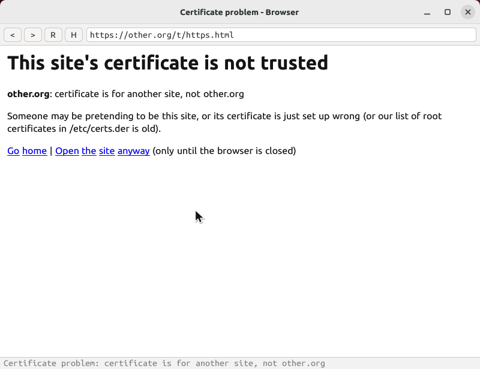

Стек браузера говорит на TLS 1.3. Сервер, у которого есть только TLS 1.2,
получает ошибку `protocol_version`. Такой адрес браузер открывает через
[FrogFind](http://frogfind.com): сервис сам забирает страницу и отдаёт упрощённый
HTML по HTTP. Поиск из адресной строки идёт тем же путём.

У браузерного стека пока нет отзыва сертификатов (OCSP/CRL), кривой P-521,
Ed25519 и защиты от атак по времени в P-256 (ключ сессии одноразовый).
Проверка у себя: на компьютере `openssl s_server -accept 4433 -cert c.pem -key k.pem -WWW`,
в MyOS `wget -k https://10.0.2.2:4433/файл`. Тесты: `make test` (ответы из RFC
и FIPS, чтение корней Mozilla) и `make x509test` (цепочки RSA/ECDSA, просроченный
сертификат, чужое имя, самоподписанный, подписи PSS, PKCS#1 и ECDSA; нужен
`pip install cryptography`).

`tls.c` и `x509.c` собираются gcc: там 64-битная арифметика, которой нет у `cc`
внутри MyOS. К браузеру они подключаются при сборке на компьютере. Своя
программа на этом стеке: `#include "tls.h"`, затем `tls_open`, `tls_cert_ok`,
`tls_read`, `tls_write`, `tls_close`.

## Браузер

Browser сам забирает страницу по HTTP или HTTPS и сам раскладывает HTML.

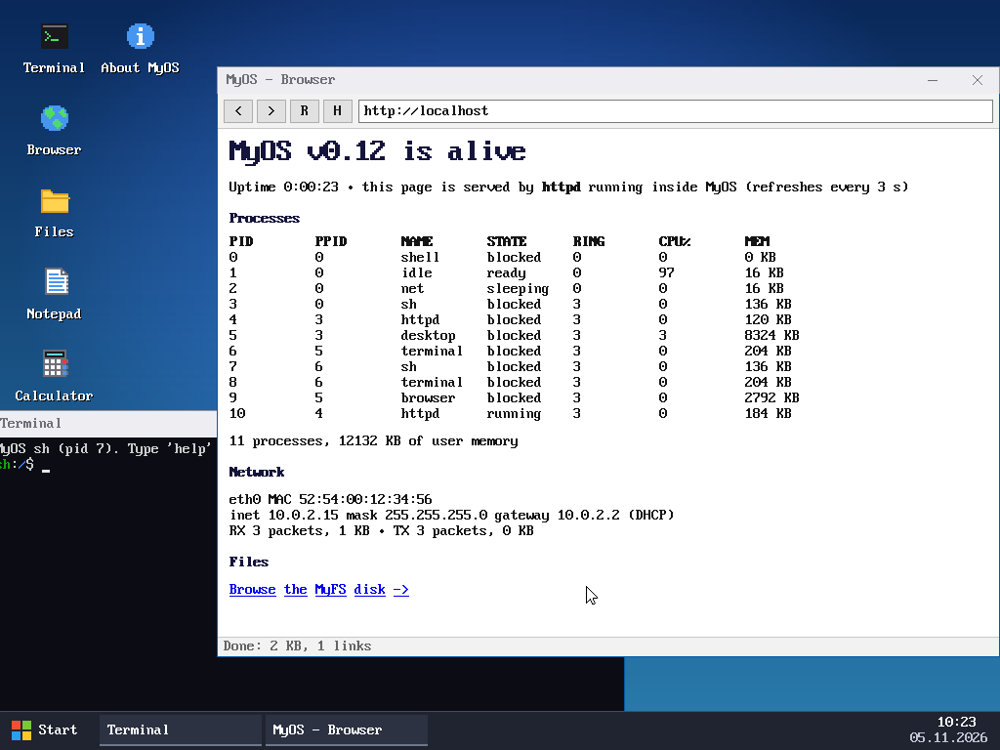

Он понимает заголовки, абзацы, жирный и курсив, ссылки, списки, `<pre>`,
таблицы колонками, линии, `<center>`, формы с полем и кнопкой, редиректы,
сущности `&amp;`, UTF-8 и windows-1251. Строка адреса (Ctrl+L) принимает
`example.com`, `http://...`, `file:/путь` или слова для поиска. Кнопки `<` и
`>` листают историю, `R` обновляет, `H` открывает домашнюю страницу.
`http://localhost/` — страница самой системы, если в терминале запущен `httpd`.

Картинки `` декодируются своим кодом (`user/lib/img.c`): PNG, GIF (первый
кадр), JPEG, в том числе прогрессивный, BMP и `data:image/...;base64`.
Страница показывается сразу, картинки догружаются по одной, сначала те, что
на экране. Огромный JPEG уменьшается ещё при распаковке. Кэш пикселей — до
20 МБ. Esc прекращает догрузку.

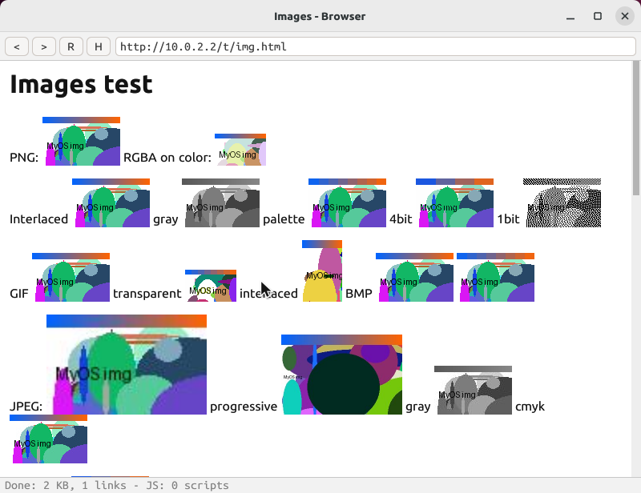

У каждого запроса есть срок. Скрипты и стили страницы ограничены общим
бюджетом времени. Пока страница грузится, окно отвечает: Esc или кнопка на
месте R останавливают загрузку, крестик закрывает окно, размер можно менять.
Счётчики и рекламные домены не запрашиваются. Скачанные скрипты и стили
кэшируются на сеанс. Слишком глубокая страница или скрипт дают ошибку, а не
переполнение стека. Кончилась память — скрипты останавливаются, окно живёт.
`browser -v адрес` пишет строки статуса ещё и в консоль, `make run` сохраняет
их в `build/serial.log`. `make browsertest` гоняет браузер на Linux под
AddressSanitizer.

Стили (`user/lib/css.c`) читают `<style>`, `<link rel=stylesheet>`, `@import`
и `style=""`. Каскад учитывает специфичность, `!important` и наследование.
Есть переменные `var(--x)`, `calc()`, `min()`, `max()`, `clamp()` и `@media`.
Раскладка берёт `display` (блок, строка, `inline-block`, `flex` в строку,
`none`), отступы, рамки, фон, цвет и жирность текста, выравнивание,
`text-transform`, `white-space: pre`, маркеры списков и колонку
`max-width` с `margin: auto`. Спрятанное через `display:none`,
`visibility:hidden`, нулевую высоту с `overflow:hidden` и похожие приёмы
остаётся спрятанным. Ctrl+U выключает стили страницы. Текущий охват свойств,
маски, тени и проверки сайтов — в [docs/browser.md](docs/browser.md).

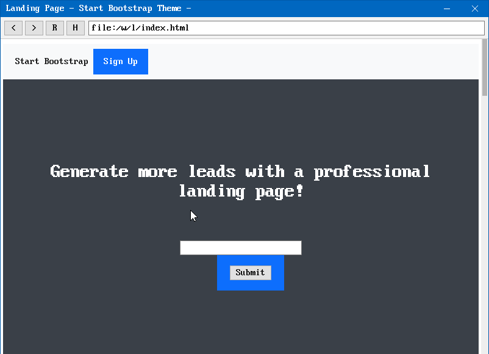

### JavaScript

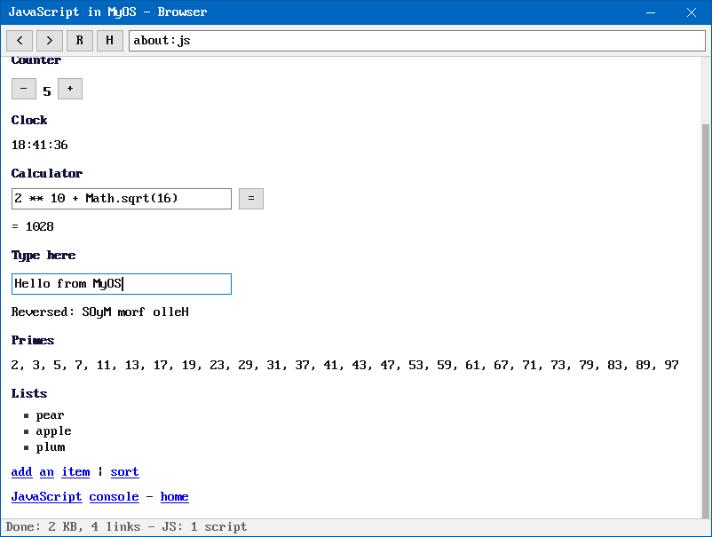

Интерпретатор свой: исходник, токены, дерево, обход дерева. Имена переменных
разрешаются до выполнения, поэтому во время прохода их не ищут по строке.

| Файл | Что внутри |
|---|---|
| `user/lib/js.c` | значения, строки, объекты, преобразования, сборщик мусора |
| `user/lib/jsparse.c` | лексер, парсер, разрешение имён |
| `user/lib/jsrun.c` | выполнение, функции, классы, деструктуризация, генераторы и async |
| `user/lib/jslib.c`, `jslib2.c` | Object, Function, Error, Number, Math, Symbol, Proxy, Reflect, Array, String, JSON, Date, Map/Set, Promise, типизированные массивы |
| `user/lib/jsnum.c` | печать и разбор `double`, математика через x87 |
| `user/lib/jsre.c` | регулярные выражения: байт-код и поиск с возвратами |
| `user/lib/dom.c` | дерево документа, `document.write`, селекторы |
| `user/lib/css.c` | таблицы стилей и вычисленный стиль |
| `user/lib/domjs.c`, `dom_prelude.js` | document, элементы, window, события, таймеры, location, cookie, fetch, localStorage, URL |

Язык покрывает ES5 и привычное из более новых редакций: `let` и `const`,
стрелки, классы, шаблонные строки, деструктуризация, `for-of`, генераторы,
`async`/`await`, `?.`, `??`, `**`, Symbol, Proxy и `with`. Подмножество
модулей `import`/`export` выполняет браузер, границы описаны
в [docs/modules.md](docs/modules.md). Async-генераторов и WebAssembly нет.
Строки хранятся байтами UTF-8, поэтому `length` у кириллицы считается в байтах.

Страница разбирается в дерево DOM. Скрипты выполняются по ходу разбора.
Дерево превращается обратно в простой HTML, и его раскладывает прежний код
браузера. После щелчков, таймеров и `fetch` раскладка пересчитывается, если
скрипты изменили дерево. Щелчок по тексту шлёт `click` элементу и выше по
предкам. Сборщик мусора «пометить и вымести» запускается, когда ни один скрипт
не выполняется. Генераторы и `async` живут на своих стеках, сборщик смотрит
их отдельно. У программ MyOS основной стек 1 МиБ, JavaScript выполняется на
стеке в 2 МБ.

Страница `about:js` показывает примеры. Ctrl+K открывает консоль, Ctrl+J
выключает JavaScript. Заметки о совместимости отдельных сайтов лежат
в [docs/compatibility.md](docs/compatibility.md).

```
sh:/$ js
MyOS JavaScript. Type an expression, empty line or Ctrl+D to quit.
> [1,2,3].map(x => x*x).join('+') + ' ' + (0.1+0.2)
'1+4+9 0.30000000000000004'
> function* nat() { let n = 1; while (true) yield n++; }
> var g = nat(); [g.next().value, g.next().value, g.next().value]
[1, 2, 3]
```

`js файл.js` выполняет файл. `make jstest` гоняет язык, генераторы, async
и DOM (`tests/js`, `tests/web`). `build/dom-host страница.html` поднимает
браузерный DOM без окна.

## Компилятор cc

`cc` работает внутри MyOS. Он сам переводит Си в машинный код x86, собирает
объектные файлы и записывает ELF, который ядро запускает как любую программу.

```
sh:/$ cc hi.c                    # программа hi в той же папке
sh:/$ cc -o /bin/hi hi.c         # сразу в /bin
sh:/$ cc a.c b.c -o prog         # несколько файлов
sh:/$ cc -c a.c b.c              # только a.o и b.o
sh:/$ cc main.c a.o b.o -o prog
sh:/$ ar rcs libab.a a.o b.o
sh:/$ cc main.c -L. -lab
sh:/$ cc -fPIC hi.c
sh:/$ cc -shared -o libfoo.so foo.c
sh:/$ cc main.c -L. -lfoo
sh:/$ cc -static main.c          # один файл, без .so
sh:/$ cc -E hi.c                 # текст после препроцессора
sh:/$ time cc /src/snake.c
```

Объектный файл — ELF `ET_REL` для i386. Его понимают binutils (`objdump`,
`readelf`, `ld -r`). `cc` принимает и объекты gcc `-m32 -fno-pic`
(перемещения `R_386_32`, `R_386_PC32`, `R_386_PLT32`). Конструкторов
`.init_array` нет. Соглашение о вызовах — i386 System V: `ebx`, `esi`, `edi`
сохраняются, скрытый адрес возвращаемой структуры функция снимает сама (`ret 4`).

`cc -fPIC` не кладёт в код абсолютных адресов. В такой функции `ebx` указывает
на `_GLOBAL_OFFSET_TABLE_`: глобальная переменная читается через `R_386_GOT32`,
своя статическая — через `R_386_GOTOFF`, внешняя функция — через `R_386_PLT32`.
Обычный объект и объект `-fPIC` можно соединить в одной программе.

`cc -shared` собирает разделяемую библиотеку: позиционно-независимый код,
таблица символов и перемещения. Программа с `.so` получает интерпретатор
`/lib/ld.so`. Вызов функции библиотеки идёт через PLT, её глобальные
переменные копируются в программу (`R_386_COPY`). Загрузчик перемещает себя,
ищет `DT_NEEDED` в `LD_LIBRARY_PATH`, `/lib` и `/usr/lib`, связывает символы
сразу и вызывает `DT_INIT_ARRAY`. `dlopen`, `dlsym` и `dlclose` экспортирует
сам `ld.so`. `-static` ищет только архивы и собирает один файл. Программы
в `/bin` собраны динамически против `libc.so` и `libgfx.so`. `sh` и `cc`
остаются статическими, поэтому оболочка запускается и со сломанной библиотекой.

Исходники программ лежат в `/src`: `cc /src/snake.c -o mysnake`. Там же
исходник компилятора: `cc /src/cc/*.c -o cc2`.

Язык — почти весь Си:

- `int`, `char`, `short`, `unsigned`, `_Bool` / `bool`, `float`, `double`, `enum`;
- указатели, массивы, в том числе многомерные, `struct`, `union`, `typedef`, указатели на функции;
- присваивание структур, передача и возврат из функций;
- `if`, `for`, `while`, `do`, `switch` (включая `case 1 ... 5:`), `goto`, `break`, `continue`;
- функции с `...` и `va_list`;
- препроцессор: `#include`, `#define` с параметрами, `#` и `##`, `#if` / `#ifdef` / `#elif`;
- инициализаторы `int a[] = {1, 2}`, `struct p q = { .x = 1 }`, строки в массивах.

`long` — 32 бита, `long long` — 64. Для системных вызовов есть
`__syscall(номер, a, b, ...)`.

Заголовки — `/include/myos.h` и `/include/gfx.h`. Архивы `/lib/libc.a` и
`/lib/libgfx.a` отдают в программу только нужные функции. Если архивов на диске
нет, `cc` компилирует исходники `/lib/libc.c`, `gfx.c`, `vec.c`, `font.c`, `win.c`.

Статические библиотеки — архивы `ar` в формате GNU, с индексом символов.
`ar rcs` создаёт или обновляет архив, `ar t` показывает состав, `ar x`
извлекает, `ar d` удаляет, `ranlib` пересчитывает индекс. `cc ... -lNAME`
ищет `libNAME.a` в каталогах `-L`, затем в `/lib` и `/usr/lib`. Из архива
берутся только члены, которые закрывают недостающие символы. Своё определение
функции заменяет библиотечное: свой `malloc` будет вызывать и libc. Архивы
GNU ar и объекты gcc `-m32 -fno-pic` подходят. Наш `ar` пишет те же байты,
что `ar rcsD` из binutils.

Пересобрать libc (нужно около 230 КБ свободного места):

```
sh:/$ cc -c /lib/libc.c -o /tmp/libc.o
sh:/$ ar rcs /lib/libc.a /tmp/libc.o
sh:/$ rm /tmp/libc.o
```

Устройство (`user/cc/`): `lex.c` режет текст на токены, `pp.c` раскрывает
макросы на токенах, `parse.c` строит дерево рекурсивным спуском, `gen.c`
пишет байты x86 (целое в `eax`, дробное в `st(0)`, промежуточные значения
в стеке), `link.c` читает `.o` и `.a` и записывает ELF с базы `0x40000000`.

`make cctest` гоняет `tests/cc/`, проверяет, что компилятор, собранный самим
собой, повторяет себя байт в байт, и прогоняет раздельную компиляцию
(`tests/cclink.sh`), библиотеки (`tests/cclib.sh`) и `cc -shared`
(`tests/ccshared.sh`).

Свой `make` внутри системы умеет параллельные цели, `make -j4`. Как выбирается
число задач — в [docs/parallel-build.md](docs/parallel-build.md).

## Учётные записи и службы

Интерактивная оболочка спрашивает логин и пароль. Пароль на экране не виден
и в историю не попадает. Команды: `whoami`, `useradd NAME`, `passwd`,
`logout`. Записи лежат в `/etc/accounts`, пароль хранится как соль и несколько
раундов SHA-256. Домашний каталог получает владельца и режим `0700`.
Пределы и наследование UID — в [docs/users.md](docs/users.md).

`sysinfo` печатает версию ядра, полный Git-хеш, время сборки, CPU, память,
графику, диски и сеть. Тот же вывод есть у оболочки ядра. Формат структуры
для программ — в [docs/sysinfo.md](docs/sysinfo.md). Проверка: `make sysinfotest`.

Менеджер служб стартует после диска и до входа в оболочку. Это свой
`systemctl`, определения лежат в `/etc/services`.

```
systemctl enable desktop          включить рабочий стол со следующей загрузки
systemctl enable --now httpd      включить и запустить HTTP-сервер
systemctl start httpd
systemctl stop httpd
systemctl restart httpd
systemctl status httpd
systemctl disable --now desktop
```

Команды, которые меняют состояние, выполняются от root. Журнал службы —
`/var/log/<имя>.service`. Повторный запуск после сбоя, `User=root` и список
команд — в [docs/services.md](docs/services.md).

## Сборка и запуск

Общие параметры — в `.env` в корне репозитория. Пример — `.env.example`.
Там размер нового диска, память и число CPU QEMU, видео, проброс портов,
живой USB и netboot. Правила разбора файла — в [docs/environment.md](docs/environment.md).

Один раз поставьте инструменты: `build-essential`, `nasm`, `qemu-system-x86`
(в WSL это пакеты Ubuntu). Дальше из каталога проекта:

```bash
make run          # ядро, программы, установка на диск, QEMU
make test         # файловая система, куча, TLS и сертификаты на компьютере
make cctest       # компилятор, в том числе сборка им самого себя
make jstest       # JavaScript, DOM и CSS
make browsertest  # браузер на Linux под AddressSanitizer
make imgtest      # PNG, GIF, JPEG и BMP
make x509test     # цепочки сертификатов
make gfxtest      # пробная картинка контуров и шрифтов
make tartest      # tar и tar.gz
make cleandisk    # удалить disk.img; следующий запуск создаст том заново
```

`make debug` запускает QEMU с GDB на порту 1234:
`gdb build/kernel.elf -ex "target remote :1234"`.

Видео, число CPU, память и порты берутся из `.env`. Ручная строка QEMU быстро
расходится с `make run`: загрузочный образ, AHCI-том и выбор VirtIO собирает
`tools/run_qemu.py`.

## Исходники

```
boot/boot.asm         загрузочный сектор
kernel/entry.asm      точка входа, обнуление .bss
kernel/isr.asm        заглушки прерываний и общий обработчик
kernel/kernel.c       kmain()
kernel/gdt.c          GDT, кольцо 3 и TSS
kernel/idt.c          IDT, PIC, исключения
kernel/timer.c        PIT
kernel/keyboard.c     PS/2, раскладки US и ЙЦУКЕН
kernel/mouse.c        мышь PS/2
kernel/smp.c          запуск остальных CPU
kernel/task.c         задачи, сон, ожидание, мьютексы
kernel/process.c      ELF, процессы, Ctrl+C
kernel/syscall.c      int 0x80
kernel/pmm.c          физические кадры и карта E820
kernel/paging.c       страницы
kernel/heap.c         kmalloc / kfree / krealloc
kernel/file.c         открытые файлы, консоль, каналы
kernel/tty.c          псевдотерминалы
kernel/fs.c           VFS
kernel/myfs.c         MyFS
kernel/ata.c          ATA PIO
kernel/ahci.c         AHCI, том QEMU
kernel/pci.c          конфигурация PCI
kernel/fb.c           SVGA II и Bochs VBE
kernel/display.c      смена разрешения, /etc/display
kernel/e1000.c        Intel e1000
kernel/net.c          Ethernet, ARP, IPv4, ICMP, UDP, DHCP
kernel/tcp.c          TCP
kernel/socket.c       сокеты
kernel/ipc.c          общая память, сообщения, службы, часы RTC
kernel/shell.c        оболочка ядра
linker.ld             ядро по адресу 0x10000

user/sh.c             оболочка
user/lib/             libc, gfx, окна, шрифты, контуры, TLS, картинки, JS
user/cc/              компилятор: lex, pp, parse, gen, link
user/desktop.c        рабочий стол
user/browser.c        браузер
user/user.ld          программа с 0x40000000
fonts/                Ubuntu и Ubuntu Mono, лицензия UFL
certs/roots.der       корневые сертификаты Mozilla

tools/myfs.c          образ диска на компьютере: ls, put, cat, rm, grow
ext/instructions/     рецепты портов, см. docs/ext.md
Makefile
```

Программы стола, сеть (`ifconfig`, `ping`, `host`, `wget`, `download`, `httpd`)
и утилиты лежат рядом, в `user/*.c`. Библиотеки libcurl и OpenSSL в
`user/lib/curl` и `user/lib/openssl` обслуживают `wget` и `download`; браузер
их не использует.

## Подробнее

Устройство системы, по слоям:

| Тема | Документ |
|---|---|
| Журнал MyFS, `fsync`, живой USB | [docs/persistence.md](docs/persistence.md) |
| Диски, разделы, `mount` | [docs/storage.md](docs/storage.md) |
| Права файлов | [docs/permissions.md](docs/permissions.md) |
| Учётные записи | [docs/users.md](docs/users.md) |
| `kill`, общая память, стеки | [docs/isolation.md](docs/isolation.md) |
| Потоки программ | [docs/threads.md](docs/threads.md) |
| Несколько CPU | [docs/smp.md](docs/smp.md) |
| Очереди планировщика | [docs/scheduler.md](docs/scheduler.md) |
| Блокировки ядра | [docs/kernel-locking.md](docs/kernel-locking.md) |
| Службы | [docs/services.md](docs/services.md) |
| Запуск окон | [docs/process-launch.md](docs/process-launch.md) |
| Буфер обмена | [docs/clipboard.md](docs/clipboard.md) |
| Колесо мыши | [docs/mouse-wheel.md](docs/mouse-wheel.md) |
| Записи приложений | [docs/apps.md](docs/apps.md) |
| Панель настроек | [docs/settings.md](docs/settings.md) |
| Редактор Code | [docs/code-editor.md](docs/code-editor.md) |
| VirtIO-GPU | [docs/gpu.md](docs/gpu.md) |
| Ethernet на ПК | [docs/ethernet.md](docs/ethernet.md) |
| `sysinfo` | [docs/sysinfo.md](docs/sysinfo.md) |
| Загрузка с USB | [docs/hardware.md](docs/hardware.md) |
| PCI и порты | [docs/hardware-inventory.md](docs/hardware-inventory.md) |
| VBE и NVIDIA | [docs/nvidia.md](docs/nvidia.md) |
| iPXE | [docs/netboot.md](docs/netboot.md) |
| USB-клавиатура после загрузки | [docs/usb-hotplug.md](docs/usb-hotplug.md) |
| `.env` | [docs/environment.md](docs/environment.md) |
| `make -j` внутри MyOS | [docs/parallel-build.md](docs/parallel-build.md) |
| Стили и совместимость браузера | [docs/browser.md](docs/browser.md) |
| Модули JavaScript | [docs/modules.md](docs/modules.md) |

Порты чужих программ — отдельным списком, в [docs/ext.md](docs/ext.md):
[Lua](docs/lua.md), [CPython](docs/python.md), [OpenSSH](docs/openssh.md),
[GNU nano](docs/nano.md), Bash, Git и sbase grep. Автоустановка в живой образ —
[docs/ext-autoinstall.md](docs/ext-autoinstall.md). libcurl и OpenSSL для
`wget` и `download` — [docs/libcurl.md](docs/libcurl.md).
