# MyOS

Учебная операционная система, написанная с нуля: свой загрузчик на ассемблере
и ядро на C для x86 (32-битный защищённый режим).

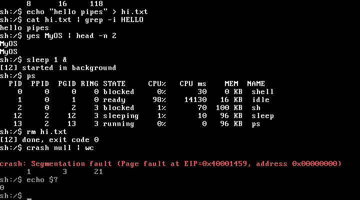

| `mandel` — фрактал на `double` | `paint` — рисование мышью |
|---|---|
| 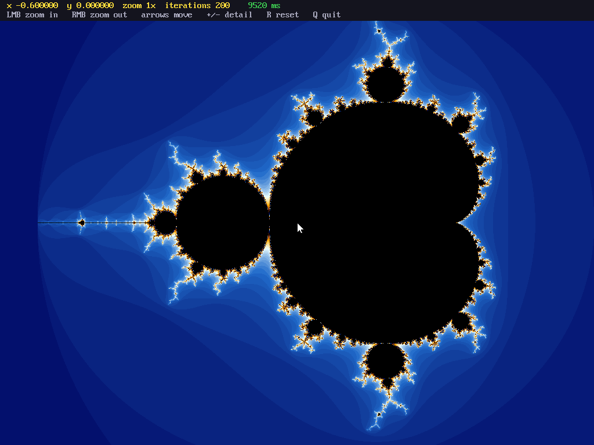 | 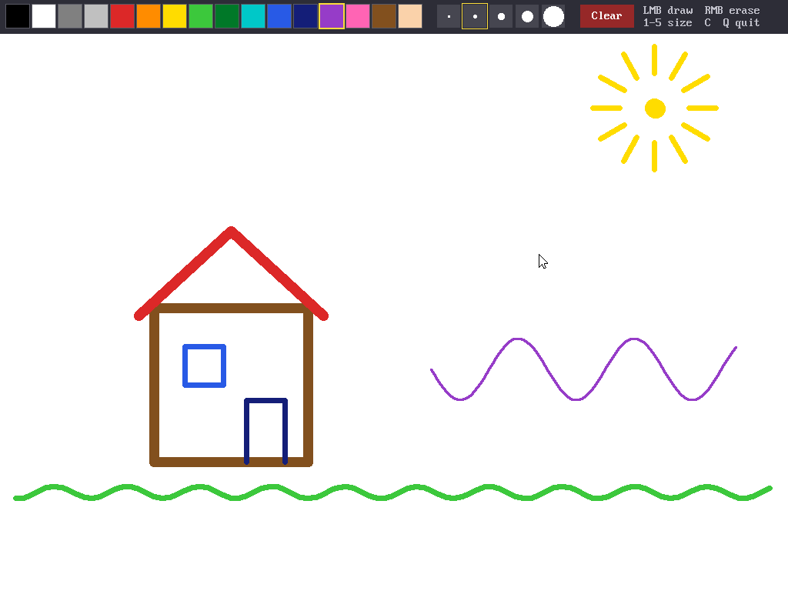 |
| редактор `edit` | игра `snake` |
| 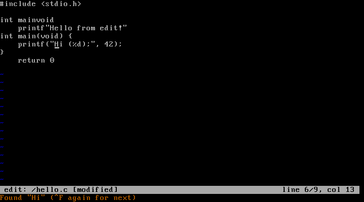 | 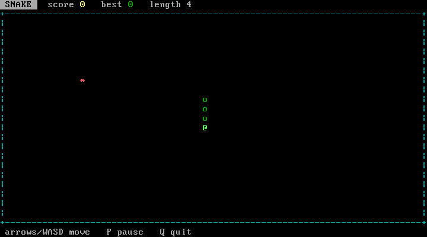 |

## Что уже умеет

- **Загрузчик** (`boot/boot.asm`, 512 байт): читает ядро с диска через BIOS
  INT 13h (LBA), включает A20, загружает GDT, переходит в защищённый режим.
- **Ядро**: текстовая консоль VGA с прокруткой и цветами, `kprintf`.
- **Прерывания**: IDT, переназначение PIC 8259, обработка исключений CPU
  (экран паники с регистрами).
- **Память**: карта памяти от BIOS (E820), физический аллокатор страниц,
  страничная адресация (paging), куча ядра `kmalloc` / `kfree` / `krealloc`.
- **Многозадачность**: потоки ядра, вытесняющий планировщик (round robin,
  квант 20 мс), сон и ожидание событий, мьютексы. Падение потока не роняет систему.
- **Программы в кольце 3**: у каждого процесса своё адресное пространство,
  загрузчик ELF, системные вызовы через `int 0x80`, мини-libc (`printf`, `malloc`,
  файлы), запуск в фоне (`&`), Ctrl+C. Программы лежат в `/bin` на диске MyFS.
- **Процессы как в Unix**: `fork`, `exec`, `waitpid`, каналы (`pipe`), `dup2`,
  группы процессов, сироты, SIGPIPE. Система загружается прямо в **`/bin/sh`** —
  оболочку-программу с конвейерами `|`, перенаправлениями `>` `>>` `<`, фоном `&`,
  кавычками, `$?`, шаблонами `*` `?`, историей (↑↓) и Tab-дополнением.
- **Графика и видеокарта**: драйвер **VMware SVGA II** — очередь команд GPU (FIFO),
  аппаратное копирование прямоугольников (прокрутка консоли, перетаскивание окон),
  заливка, **аппаратный курсор**; запасной драйвер Bochs VBE. **Разрешение меняется
  на лету** — от 640×480 до 1920×1200 (и выше, если хватает видеопамяти): программа
  **Display** на рабочем столе или команда **`mode 1280x720`**, выбор запоминается в
  `/etc/display`. Графическая консоль шрифтом 8×16, мышь PS/2, сохранение FPU при
  переключении задач (программам можно `float`/`double`), библиотека `gfx` для программ.
  Программы **`mandel`** и **`paint`**.
- **Сеть**: драйвер карты Intel e1000 (её даёт QEMU), свой стек TCP/IP — Ethernet,
  ARP, IPv4, ICMP, UDP, DHCP, TCP (рукопожатие, окно, повторная отправка, закрытие),
  петля 127.0.0.1. Сокеты — обычные дескрипторы. Программы **`ifconfig`**, **`ping`**,
  **`host`** (DNS), **`wget`** и веб-сервер **`httpd`**, который открывается в браузере Windows.
- **Рабочий стол с окнами**, как в Windows: панель задач, меню «Пуск», часы, значки,
  окна перетаскиваются и сворачиваются. Программы: Браузер, Терминал, Проводник, Блокнот,
  Калькулятор, Paint, Сапёр, Диспетчер задач. Свои оконные программы можно писать
  и компилировать прямо в MyOS (`win.h`).
- **Свой JavaScript**: движок (`user/lib/js*.c`, ~10 тыс. строк) и DOM для браузера —
  сайты, которые просят «включите JavaScript», теперь работают. Проверено на jQuery,
  React 18, Vue 3, Alpine, Preact, htmx, lodash, moment, axios. Есть и программа **`js`**
  для терминала.
- **Стили CSS** в браузере (`user/lib/css.c`): `<style>`, `<link rel=stylesheet>`,
  `@import`, каскад, `var(--x)`, `calc()`, `@media` — сайты на Bootstrap и с тёмными
  шапками выглядят похоже на себя: цвета, фон, рамки, отступы, колонка по центру,
  меню в строку, спрятанное — спрятано.
- **Свой компилятор Си `cc`** прямо внутри MyOS: пишешь программу в `edit`, `cc prog.c`,
  `./prog` — без WSL. Компилятор сам переводит Си в машинный код x86 и сам собирает ELF;
  он собирает все программы из `/bin` и даже сам себя.
- **Терминал**: escape-последовательности ANSI (курсор, цвета, очистка), сырой и
  неблокирующий режимы ввода. На этом сделаны полноэкранные программы: редактор
  **`edit`**, игра **`snake`**, **`top`**.
- **Таймер** PIT на 100 Гц: `uptime`, `sleep`.
- **Клавиатура** PS/2: Shift, CapsLock, стрелки.
- **Драйвер диска ATA** (PIO, LBA28): чтение и запись секторов без BIOS.
- **Файловая система MyFS** с каталогами; файлы хранятся на `disk.img` и
  переживают перезагрузку.
- **Оболочка ядра** (кольцо 0, запасная: в неё попадаешь по `exit` из `sh`): системные команды (`help`, `clear`, `echo`, `about`, `uptime`,
  `color`, `history`, `sleep`, `panic`, `reboot`, `halt`) и файловые
  (`ls`, `tree`, `cd`, `pwd`, `mkdir`, `touch`, `cat`, `write`, `edit`,
  `cp`, `mv`, `rm`, `df`, `format`), плюс `echo текст > файл` и `>> файл`,
  команды памяти (`mem`, `heaptest`, `peek`, `panic pf`) и задач (`ps`, `spawn`, `kill`, `run`).
  Любая неизвестная команда ищется как программа в `/bin`.

## Пример

После загрузки ты в `/bin/sh`:

```
sh:/$ ls /bin | grep s | wc              конвейер из трёх процессов
sh:/$ echo "hello pipes" > hi.txt        вывод в файл (>> — дописать)
sh:/$ cat hi.txt | grep -i HELLO
sh:/$ wc < hi.txt                        ввод из файла
sh:/$ yes MyOS | head -n 2               yes умрёт от SIGPIPE, когда head выйдет
sh:/$ sleep 5 &                          в фоне; потом: ps, kill <pid>
sh:/$ yes | grep y | wc                  ...и Ctrl+C убьёт весь конвейер
sh:/$ ls /bin/c*                         шаблоны; Tab дополняет команды и имена файлов
sh:/$ edit /notes.txt                    редактор: ^S сохранить, ^Q выйти, ^K/^U, ^F, ^G
sh:/$ snake                              змейка: стрелки/WASD, P пауза, Q выход
sh:/$ top                                процессы, обновление раз в секунду
sh:/$ mandel                             фрактал: ЛКМ приблизить, ПКМ отдалить, стрелки, +/-, Q
sh:/$ paint                              рисование: палитра сверху, 1-5 толщина, C очистить, Q
sh:/$ fputest 20000000 &                 запусти 2-3 копии: результаты должны совпасть
sh:/$ sh /script.sh                      команды из файла
sh:/$ exit                               в оболочку ядра
```

В оболочке ядра (`myos:/>`):

```
myos:/> mkdir docs
myos:/> echo Hello from MyFS! > docs/hello.txt
myos:/> echo second line >> docs/hello.txt
myos:/> cd docs
myos:/docs> cat hello.txt
Hello from MyFS!
second line
myos:/docs> edit notes.txt        # построчный редактор, '.' — сохранить и выйти
myos:/docs> cp hello.txt ../copy.txt
myos:/docs> cd ..
myos:/> tree
myos:/> df
```

## Как загружается система

```
BIOS ──> сектор 0 (boot.bin) по адресу 0x7C00, 16-битный реальный режим
           │  INT 13h: читает сектора 1..N  ──> 0x10000
           │  INT 15h E820: карта памяти    ──> 0x8000
           │  A20 ─> GDT ─> CR0.PE=1 ─> far jmp
           ▼
         32-битный защищённый режим ──> _start (entry.asm) ──> kmain() (kernel.c)
```

Два диска (оба на первичном IDE-канале):

| Диск | Роль | Содержимое |
|------|------|------------|
| `build/os.img` (master) | загрузочный | `[boot.bin][kernel.bin]`, пересобирается при `make` |
| `disk.img` (slave)      | данные      | файловая система MyFS, 4 МБ, `make` его не трогает |

## Память

```
Физическая память                      Виртуальная память (после включения paging)
0x00000000  IVT, BIOS data             0x00000000  НЕ отображена -> NULL = page fault
0x00007C00  загрузчик                  0x00001000 ┐
0x00008000  карта E820                            │ 1:1 (identity), страницы по 4 КБ
0x00010000  ядро (.text .data .bss)               │
0x00090000  стек ядра (растёт вниз)               │
0x000B8000  видеопамять VGA            0x003FFFFF ┘
0x00100000  ┐ свободная RAM:           0x00400000 ┐ 1:1, «большие» страницы по 4 МБ
            │ раздаёт PMM фреймами     ...        ┘ до конца RAM (не выше 3 ГБ)
 конец RAM  ┘ по 4 КБ                  0xD0000000 ┐ куча ядра: страницы подключаются
                                       0xDFFFFFFF ┘ по мере роста (до 256 МБ)
```

- **PMM** (`kernel/pmm.c`): битовая карта, 1 бит на фрейм 4 КБ. Свободным считается
  только то, что BIOS пометил как `usable`; первый мегабайт не раздаётся никогда.
- **Paging** (`kernel/paging.c`): каталог страниц + таблицы. `vmm_map`, `vmm_unmap`,
  `vmm_translate`. Страница 0 пустая, поэтому разыменование NULL сразу видно
  (экран паники показывает адрес из CR2).
- **Куча** (`kernel/heap.c`): блоки с 16-байтными заголовками в двусвязном списке,
  first fit, разрезание и склейка соседних свободных блоков. Двойное освобождение
  и «чужие» указатели ловятся проверкой magic-числа (`panic double` это показывает).
- Ограничение: RAM используется только до 1 ГБ. Адреса 1–3 ГБ отданы программам.

Попробуй: `mem`, `heaptest 5000`, `peek 0xB8000 64`, `peek 0xD0000000`, `panic pf`.
Запуск с другим объёмом RAM: `make run QEMU_MEM=512M`.

## Многозадачность

```
  задача A работает ──> IRQ0 (таймер) ──> isr_common кладёт регистры A на стек A
                                             │
                                isr_handler -> sched_tick -> schedule()
                                             │  запоминает esp задачи A,
                                             │  выбирает B, возвращает esp задачи B
                                             ▼
  задача B работает <── iret <── isr_common: mov esp, eax; pop регистров B
```

- **Переключение контекста** — в `kernel/isr.asm` и `kernel/task.c`: обработчик прерывания
  возвращает указатель на сохранённые регистры, и если это регистры другой задачи,
  `iret` продолжает уже её. Новой задаче заранее рисуется кадр «как будто её прервали»
  в начале `task_entry()`.
- **Планировщик**: по кругу, квант 2 тика (20 мс). Если всем нечего делать — `idle`
  (`hlt`). `task_yield()` = `int 0x81`.
- **Состояния**: `ready`, `running`, `sleeping` (`sleep_ms`), `blocked` (ждёт события,
  например клавишу или мьютекс), `zombie` (завершилась, стек освободят позже).
- **Синхронизация**: куча и экран — короткие участки с `cli` (`irq_save`/`irq_restore`),
  файловая система — рекурсивный мьютекс (ждущая задача спит). Клавиатура будит
  оболочку из прерывания (`task_wakeup`), без гонки «потерянного пробуждения».
- **Защита**: исключение в потоке (page fault, деление на ноль) убивает только его;
  переполнение стека ловится по «красной зоне» и канарейке на дне стека.
- Ограничения: до 32 задач, стек ядра 16 КБ.

Попробуй:

```
spawn clock          часы в правом верхнем углу
spawn counter        «жадный» поток; запусти 2-3 и посмотри ps
spawn primes 5000000 конечная задача: посчитает и завершится
spawn crash          поток разыменует NULL — и умрёт только он
spawn deep           бесконечная рекурсия — переполнение стека
ps                   список задач и загрузка CPU за последнюю секунду
kill 3 / kill all
```

## Программы (пользовательский режим)

```
myos:/> hello world             программа из /bin: argc/argv, номер процесса, кольцо 3
myos:/> guess                   «угадай число» — ввод с клавиатуры через read()
myos:/> count 10 500 &          в фоне (&); посмотри ps, пока она считает
myos:/> primes 5000000          память через malloc -> sbrk
myos:/> note купить молоко      дописать строку в /notes.txt; note — показать
myos:/> wc /notes.txt           строки, слова, байты (без файла — читает клавиатуру до Ctrl+D)
myos:/> crash null|kernel|code|cli|io|stack|div|syscall|loop
```

`crash` пробует сломать систему разными способами: прочитать NULL, залезть в память
ядра, записать в свой же код, выполнить `cli` или `out`, переполнить стек, подсунуть ядру
указатель на его же память. Каждый раз умирает только программа (`Segmentation fault`),
а `crash loop` останавливается по **Ctrl+C**.

### Как это устроено

```
Адресное пространство процесса           Каталог страниц процесса
0x00000000 ┐                              записи 0..255    ┐ общие с ядром,
           │ ядро: RAM 1:1 (до 1 ГБ)      записи 832..847  ┘ без бита USER
0x40000000 ┤ .text .rodata  (R-X)         записи 256..767  — свои у каждого
           │ .data .bss     (RW-)                            процесса
           │ куча (sbrk) ↓
           │ ...
0xBFFF0000 │ стек программы 64 КБ ↑
0xC0000000 ┤ argc, argv на вершине стека
0xD0000000 ┘ куча ядра
```

- **Кольца защиты.** В GDT добавлены сегменты кольца 3 (`0x1B`, `0x23`) и TSS
  (`kernel/gdt.c`). Из TSS процессор берёт стек ядра (`esp0`), когда в программе
  случается прерывание. При каждом переключении задач планировщик пишет туда стек
  ядра следующего процесса и загружает его `CR3`.
- **Загрузка ELF** (`kernel/process.c`): сегменты `PT_LOAD` раскладываются по новым
  страницам. Код без права записи, данные с правом записи. На вершину стека
  кладутся строки аргументов, `argv[]` и `argc`. Первый `iret` с `cs = 0x1B`
  переводит процессор в кольцо 3.
- **Системные вызовы** (`kernel/syscall.c`): `int 0x80`, номер в `eax`, аргументы
  в `ebx/ecx/edx`. Это единственный шлюз IDT с DPL 3.

  | № | вызов | | № | вызов |
  |---|-------|-|---|-------|
  | 0 | `exit(code)` | | 5 | `sbrk(inc)` |
  | 1 | `write(fd, buf, len)` | | 6 | `sleep(ms)` |
  | 2 | `read(fd, buf, len)` | | 7 | `getpid()` |
  | 3 | `open(path, mode)` | | 8 | `ticks()` |
  | 4 | `close(fd)` | | 9 | `yield()` |

  Ядро проверяет каждый указатель от программы: он должен лежать в её памяти
  (1–3 ГБ), а память должна быть отображена с битом USER (и WRITE, если ядро будет туда
  писать). Иначе вызов вернёт `-EFAULT`.
- **Убийство «по-честному».** Если процесс убивают (Ctrl+C, `kill`), пока он внутри
  системного вызова, ядро не бросает работу на полпути: ставит флаг и будит процесс,
  а умирает он на выходе из ядра. Так файловая система не остаётся наполовину изменённой.
- **Коды выхода** как в Unix: `137` — убит (`128+9`), `139` — Segmentation fault (`128+11`).

### fork, exec и каналы

Как `sh` выполняет `ls /bin | wc`:

```
sh ──pipe()──> [fd 3: чтение | fd 4: запись]  (канал: буфер 4 КБ в ядре)
 │
 ├─fork()─> потомок 1: dup2(4, 1)   stdout -> канал;  exec("/bin/ls")
 ├─fork()─> потомок 2: dup2(3, 0)   stdin  <- канал;  exec("/bin/wc")
 │          (оба в одной группе процессов: Ctrl+C убьёт обоих)
 ├─close(3), close(4)               иначе wc никогда не увидит конец канала
 └─waitpid(ls), waitpid(wc)
```

- **`fork`** (`kernel/process.c`) копирует всю память процесса страница за страницей
  (`vmm_clone_user`) и его открытые файлы. Потомку достаётся копия кадра системного
  вызова с `eax = 0`, поэтому из того же `fork()` он «возвращается» с нулём.
- **`exec`** загружает новую программу в новое адресное пространство, переключает
  `CR3`, освобождает старое и подменяет кадр системного вызова: `iret` уходит в
  начало новой программы. Открытые файлы остаются, на этом построены перенаправления.
- **Открытые файлы** (`kernel/file.c`) — объекты со счётчиком ссылок: после `fork`/`dup2`
  несколько дескрипторов указывают на один объект. Канал закрывается, когда исчезает
  последняя ссылка на его конец. Читатель видит конец файла, когда писателей не
  осталось, а писатель без читателей получает `EPIPE` и умирает (код 141, как SIGPIPE).
- **Родители и сироты.** Код выхода ребёнка хранится, пока родитель не вызовет `waitpid`.
  Если родитель умер раньше, ребёнок становится сиротой, и ядро уберёт его само.
- **Группы процессов.** `sh` ставит все процессы конвейера в одну группу и говорит ядру
  (`setfg`), какая группа сейчас на экране. Ctrl+C убивает её целиком, а саму `sh` не трогает.

Системные вызовы 10–24: `fork`, `exec`, `waitpid`, `pipe`, `dup2`, `chdir`, `getcwd`,
`readdir`, `kill`, `setpgid`, `setfg`, `mkdir`, `unlink`, `ps`, `getppid`. Ошибки — `-errno`
как в Linux, `strerror()` есть в libc.

Утилиты в `/bin`: `sh`, `ls`, `cat`, `echo`, `grep [-vicn]`, `head [-n N]`, `wc`, `ps`,
`top`, `kill`, `mkdir`, `rm`, `sleep`, `yes`, `clear`, `edit`, `snake`, а также `hello`,
`guess`, `count`, `primes`, `note`, `crash`.

### Терминал и полноэкранные программы

Консоль понимает подмножество escape-последовательностей VT100/xterm (`kernel/vga.c`):

| последовательность | что делает |
|---|---|
| `ESC[r;cH` | курсор в строку r, столбец c (с 1) |
| `ESC[A` `B` `C` `D` | курсор вверх / вниз / вправо / влево |
| `ESC[2J`, `ESC[J`, `ESC[K` | очистить экран / до конца экрана / до конца строки |
| `ESC[0m` `1m` `7m` `31m`…`37m` `41m`…`47m` `90m`…`97m` | сброс, яркость, инверсия, цвета текста и фона |
| `ESC[?25l` / `ESC[?25h` | спрятать / показать курсор |

Режим терминала программа задаёт вызовом `ttymode` (№ 25):

- **обычный**: ядро само собирает строку с эхом и Backspace, программа получает её по Enter;
- `TTY_RAW`: каждая клавиша приходит сразу и без эха, стрелки, Home/End, PgUp/PgDn,
  Delete приходят как `ESC[A`, `ESC[H`, `ESC[5~`…, а Ctrl+буква — кодами 1–26;
- `TTY_NONBLOCK`: `read` не ждёт клавишу, это нужно играм;
- `TTY_NOSIG`: Ctrl+C приходит программе как код 3 и не убивает её (так `edit` не
  теряет несохранённый текст).

Режим принадлежит включившему его процессу. Если тот упадёт или его убьют, ядро
само вернёт терминал в обычное состояние. В libc есть `readkey()` (разбирает
последовательности в `KEY_UP`, `KEY_PGDN`…), `gotoxy()` и константы `ANSI_*`.

`sh` тоже работает в сыром режиме, пока ты набираешь строку: рисует её сама (←→,
Home/End, Ctrl+U/K/W/L), листает историю (↑↓, команда `history`), дополняет по Tab
команды из `/bin` и имена файлов (второй Tab показывает варианты), раскрывает `*` и `?`.

### Графика

```
 PCI: устройство класса 3 (видеокарта) ──> BAR0 = физический адрес видеопамяти (0xFD000000)
 порты 0x1CE/0x1CF (Bochs VBE): ширина 1024, высота 768, 32 бита, включить LFB
 видеопамять отображается в ядро на 0xE0000000:  пиксель (x,y) = *(u32*)(0xE0000000 + (y*1024 + x)*4)
```

- **Шрифт.** Перед переключением ядро читает шрифт 8×16 из «плоскости 2» видеопамяти
  (там его держит текстовый режим) и дальше рисует им и консоль, и текст в программах.
- **Графическая консоль** (`kernel/vga.c`). Экран по-прежнему хранится как сетка символов
  (код + цвет), но каждая изменённая клетка рисуется пикселями. ANSI-цвета, курсор и
  прокрутка работают как раньше, только терминал теперь 128×48, и все программы
  (`sh`, `edit`, `snake`, `top`) подстраиваются под его размер.
- **Экран для программы.** Программа рисует в своём буфере (`malloc` на 3 МБ) и отдаёт
  кадр ядру вызовом `gfx_blit`: целиком или только изменившийся прямоугольник. Пока
  экран захвачен (`gfx_acquire`), консоль печатает «вслепую», в сетку символов. Когда
  программа выходит, падает или её убивают по Ctrl+C, ядро перерисовывает консоль.
- **Мышь** (`kernel/mouse.c`): IRQ12, пакеты по 3 байта, координаты считает ядро.
- **FPU.** При каждом переключении задач ядро делает `fnsave` текущему процессу и
  `frstor` следующему, поэтому программы собираются уже без `-mno-80387`. `fork`
  копирует регистры FPU, `exec` даёт чистые. `printf` понимает `%f`.
- Системные вызовы 27–32: `gfx_info`, `gfx_acquire`, `gfx_blit`, `mouse`, `gfx_font`, `termsize`.
- Библиотека `user/lib/gfx.h`: `gfx_open/close/flip/flip_rect`, `gfx_pixel`, `gfx_line`,
  `gfx_thick_line`, `gfx_rect`, `gfx_fill_rect`, `gfx_circle`, `gfx_fill_circle`,
  `gfx_text`, `gfx_text_scaled`, `mouse_get`, курсор-стрелка `gfx_cursor_draw/erase`.

Мышь в QEMU: кликни в окно QEMU, чтобы оно «захватило» мышь, а **Ctrl+Alt+G** вернёт
её в Windows. Если видеокарта не Bochs VBE (например, на настоящем железе), MyOS
остаётся в текстовом режиме 80×25.

Маленькая графическая программа:

```c
#include "gfx.h"
int main(void) {
    if (gfx_open() < 0) return 1;
    gfx_clear(RGB(0, 0, 60));
    gfx_fill_circle(512, 384, 100, C_YELLOW);
    gfx_text_scaled(380, 520, "Hello, MyOS!", C_WHITE, 3);
    gfx_flip();
    while (readkey() < 0) sleep_ms(20);     /* любая клавиша */
    gfx_close();
    return 0;
}
```

### Своя программа — прямо в MyOS

```
sh:/$ edit hi.c                  # пишешь программу, Ctrl+S — сохранить, Ctrl+Q — выйти
sh:/$ cc hi.c                    # компиляция (меньше секунды)
sh:/$ ./hi Daniil
Hi, Daniil!
```

Подробнее — в разделе «Компилятор cc» ниже.

### Своя программа — через WSL

1. Создай `user/myprog.c`:
   ```c
   #include "myos.h"
   int main(int argc, char **argv) {
       printf("Hi, %s!\n", argc > 1 ? argv[1] : "stranger");
       return 0;
   }
   ```
2. `make run`. Makefile сам соберёт все `user/*.c` и положит их в `/bin` на `disk.img`.
3. В MyOS: `myprog Daniil`.

Всё, что доступно программе, описано в `user/lib/myos.h`.

## Рабочий стол

```
sh:/$ desktop
```

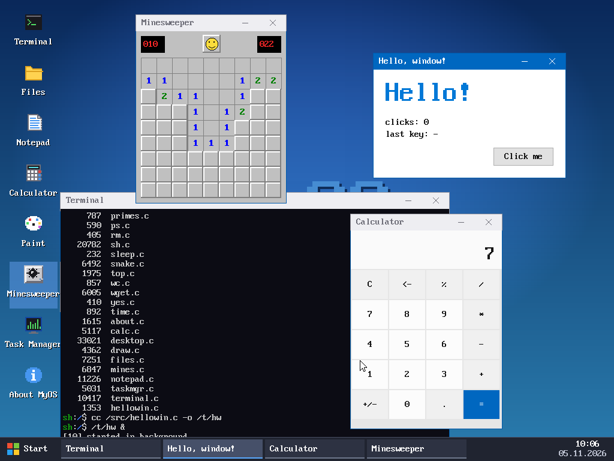

- **Значки** слева — двойной клик запускает программу. **Start** — меню со всеми
  программами и пунктом «Exit to console» (вернуться в текстовую консоль).
- **Окна** таскаются за заголовок, «_» сворачивает в панель задач, «X» закрывает.
  Клик по кнопке окна на панели задач — свернуть / развернуть. Справа — часы.
- **Terminal** — оболочка `sh` в окне: `ls`, `cc`, конвейеры, Ctrl+C, история ↑↓.
  Полноэкранные консольные программы (`edit`, `snake`, `top`, `mandel`) запускай
  вне рабочего стола.
- **Files** — проводник: двойной клик открывает папку, запускает программу или
  открывает текст в **Notepad** (Ctrl+S — сохранить, имя файла — в поле сверху).
- **Calculator**, **Paint** (правая кнопка — ластик), **Minesweeper**,
  **Task Manager** (процессы, загрузка процессора, «End task»), **About MyOS**.
- **Display** — видеокарта и разрешение: щелчок по разрешению меняет его сразу
  (рабочий стол, консоль и мышь перестраиваются без перезагрузки) и запоминает.
  Галочка «Hardware mouse cursor» — стрелку рисует сама видеокарта.

### Видеокарта (GPU)

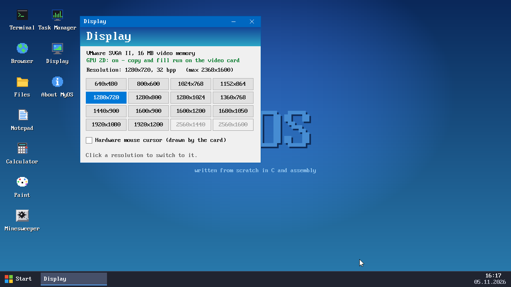

```
sh:/$ mode
Adapter:    VMware SVGA II, 16384 KB video memory
Resolution: 1280x720, 32 bpp, 5120 bytes per line
GPU 2D:     on (rect copy and fill on the card)
HW cursor:  off
Modes:      640x480 800x600 1024x768 1152x864 [1280x720] 1280x800 ... 1920x1200
sh:/$ mode 1920x1080          # сменить и запомнить
sh:/$ mode cursor hw          # аппаратный курсор на рабочем столе
```

`make run` запускает QEMU с `-vga vmware` — это видеокарта VMware SVGA II, которую
понимают QEMU, VirtualBox (VMSVGA) и VMware. `make run VGA=std` — старая Bochs VBE
(тогда всё рисует процессор, аппаратного курсора нет, но разрешение тоже меняется).

Как устроено (`kernel/fb.c`):
- Карта находится по PCI (15ad:0405). У неё три окна: порты регистров (ширина, высота,
  курсор...), видеопамять и **FIFO** — кольцевая очередь команд в памяти. Ядро
  дописывает команды в конец и сдвигает `NEXT_CMD`, карта выполняет их сама.
- `UPDATE x,y,w,h` — «покажи этот прямоугольник»: процессор рисует в видеопамять,
  а карте надо сказать, что изменилось. Консоль копит изменения и отправляет их из
  таймера (100 раз в секунду), программы — сразу после `gfx_flip`.
- `RECT_COPY` — карта сама двигает пиксели: прокрутка консоли — одна команда, а когда
  тащишь окно, рабочий стол просит карту сдвинуть его на экране (`gfx_hw_copy`) и
  дорисовывает только открывшуюся полоску.
- Заливка: `RECT_FILL` в SVGA устарела (QEMU её объявляет, но не выполняет), поэтому
  процессор заливает одну строку, а карта копирует её вниз, удваивая: 1, 2, 4, 8...
  строк — 11 команд на весь экран 1080 строк.
- Курсор: `DEFINE_CURSOR` загружает в карту картинку стрелки, дальше обработчик
  прерывания мыши просто пишет координаты в регистры.
- Перед тем как процессор сам пишет в видеопамять, ядро ждёт, пока карта доделает
  очередь (`SYNC`), иначе запоздавшее копирование затёрло бы свежие пиксели.
- QEMU применяет новый размер экрана только при перерисовке своего окна, а до этого
  отбрасывает копирования. Поэтому после смены режима ядро проверяет карту: ставит
  метку в углу и просит скопировать её на соседний пиксель — пока не сойдётся,
  копирует процессором. (В окне QEMU в это время могут мелькнуть строки
  `vmsvga_fifo_run: Unknown command 0x03` — это и есть проверка.)
- Для программ: `gfx_info2`, `gfx_set_mode`, `gfx_check_mode` (разрешение сменилось —
  буфер пересоздан), `gfx_hw_copy`, `gfx_hw_fill`, `gfx_hw_cursor`, `gfx_modes` (см. `gfx.h`).
  В ядре — системные вызовы `gfx_mode`, `gfx_info2`, `gfx_accel`, `gfx_cursor`.

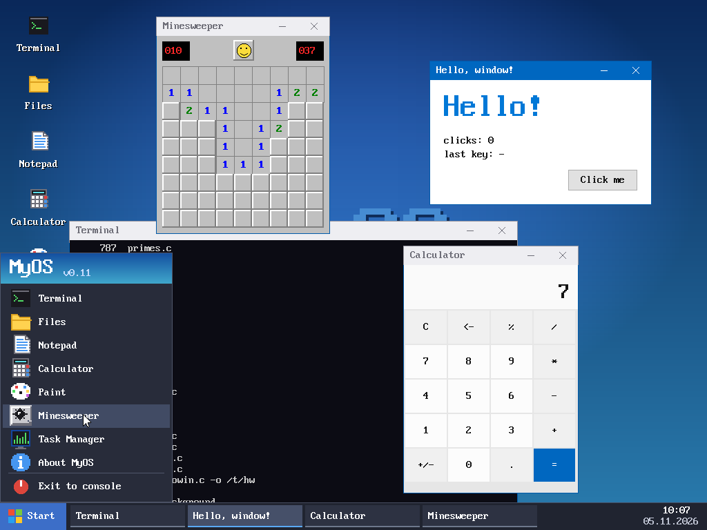

### Браузер

**Browser** — веб-браузер, написанный с нуля: сам скачивает страницу по HTTP через
сетевой стек MyOS и сам раскладывает HTML.

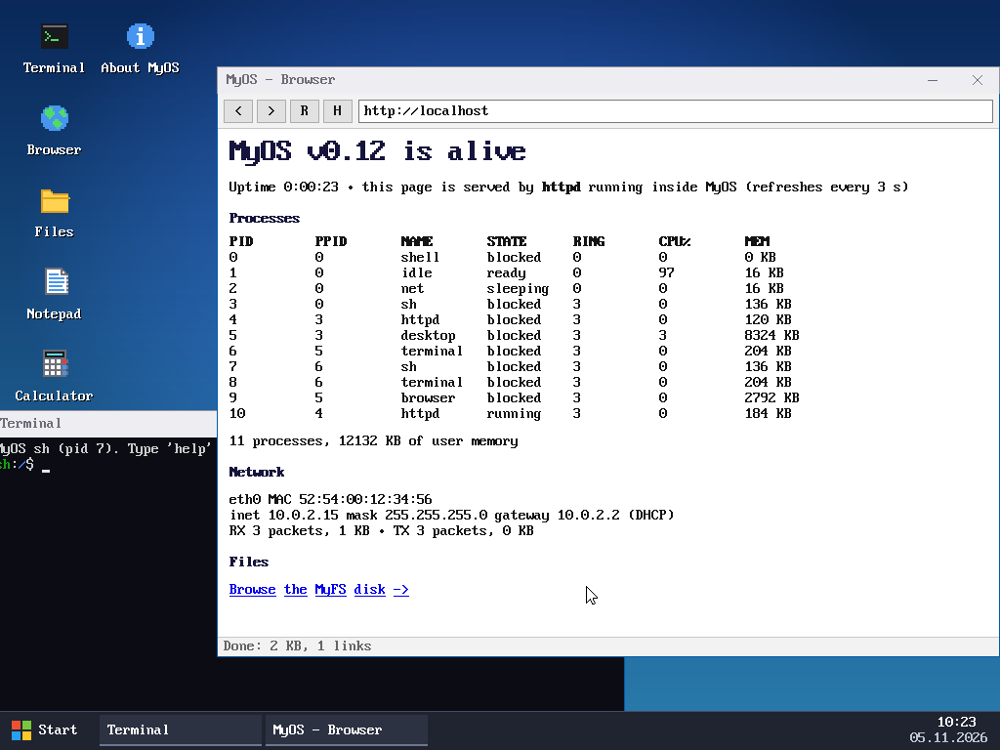

- Понимает заголовки, абзацы, жирный/курсив, ссылки, списки, `<pre>`, таблицы
  (колонками), линии, `<center>`, формы с полями ввода и кнопкой (поиск работает),
  редиректы, `&amp;`-сущности, UTF-8 и windows-1251.
- Строка адреса (Ctrl+L): `example.com`, `http://...`, `file:/путь` — файлы с диска
  MyOS, или просто слова — это поиск. Кнопки `<` `>` — назад/вперёд, `R` — обновить,
  `H` — домашняя страница со ссылками. Backspace — назад, PgUp/PgDn — листать.
- **HTTPS** — свой: `https://` адреса браузер открывает сам, через TLS 1.3
  (см. ниже «HTTPS»). В строке состояния видно шифр: `TLS 1.3, ChaCha20-Poly1305`.
  Если сайт умеет только старый TLS 1.2, страница открывается через
  [FrogFind](http://frogfind.com) — бесплатный сервис для старых компьютеров: он сам
  качает сайт и отдаёт упрощённую страницу по HTTP. Поиск — тоже через FrogFind.
- Картинки показываются рамкой с подписью. Шрифт без кириллицы, поэтому русский
  текст показывается латиницей (транслит): «Привет» → «Privet».
- `http://localhost/` — страница самой MyOS: запусти в Терминале `httpd &`.
- **CSS**: таблицы стилей страницы (`<style>`, `<link rel=stylesheet>` — скачиваются,
  `@import`, `style=""`) применяются по правилам каскада: специфичность, `!important`,
  наследование, переменные `var(--x)`, единицы `px/em/rem/%/vw/pt`, `calc()/min()/max()/clamp()`,
  `@media` (окно 788 точек, светлая тема). Из стиля раскладка берёт `display`
  (блок, строка, `inline-block`, `flex` в строку, `none`), отступы `margin/padding`,
  рамки и фон блоков, фон «кнопок» из ссылок, цвет и жирность текста, крупный шрифт
  (вдвое), выравнивание, `text-transform`, `white-space: pre`, маркеры списков,
  `max-width` + `margin: auto` (колонка по центру). Прячет то, что сайты прячут:
  `display:none`, `visibility:hidden`, `.sr-only`, `height:0; overflow:hidden`,
  `text-indent:-9999px`. Фон-картинку не рисует, но если на ней светлый текст —
  подкладывает тёмный фон. Нет float, сетки grid по колонкам, позиционирования,
  `:hover`, `::before`. Ctrl+U — выключить стили страницы.

  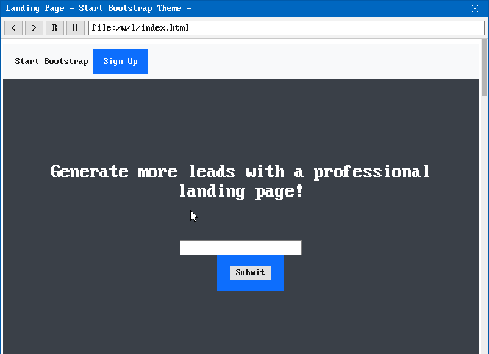

- **JavaScript** (см. ниже): страница `about:js` — примеры, Ctrl+K — консоль JS
  (`console.log` и ошибки скриптов), Ctrl+J — выключить/включить JavaScript.

### Своя программа с окном

`/src/hellowin.c` — образец. Всё рисование — те же функции `gfx_*`, что и в
полноэкранной графике, только в окно:

```c
#include "win.h"
int main(void) {
    window *w = win_create("Hello", 300, 150);
    if (!w) return 1;                         /* рабочий стол не запущен */
    gfx_clear(C_WHITE);
    gfx_text(20, 20, "Hello, window!", C_BLACK, TRANSPARENT);
    win_update(w);                            /* показать нарисованное */
    struct event e;
    while (win_event(&e, -1)) {               /* ждём события */
        if (e.type == EV_CLOSE) break;        /* нажали крестик */
        if (e.type == EV_MOUSE_DOWN) { gfx_fill_circle(e.x, e.y, 5, C_RED); win_update(w); }
    }
    return 0;
}
```

В терминале на рабочем столе: `edit` не работает, поэтому пиши в **Notepad**,
сохрани как `/my.c`, затем `cc /my.c -o /my` и `/my &`.

Как устроено:
- `desktop` — обычная программа (сервер окон). Она забирает экран, рисует обои,
  окна, панель и курсор и переносит на экран только изменившиеся прямоугольники.
- Пиксели каждого окна лежат в **общей памяти**: программа рисует в неё, а рабочий
  стол читает оттуда же — без копирования между процессами.
- Команды («создай окно», «обнови прямоугольник») и события (клавиши, мышь, «закрыть»)
  идут **сообщениями** через почтовые ящики процессов. Рабочий стол находят по имени
  службы `desktop`.
- Для этого в ядре новые системные вызовы: `shm_alloc`/`shm_map`/`shm_unmap`,
  `msg_send`/`msg_recv`, `service`, а для часов — `time` (CMOS RTC). Всё остальное
  (окна, кнопки, программы) — обычные программы, их можно менять и пересобирать
  прямо в MyOS: исходники в `/src`.

## Сеть

QEMU (`make run` запускает его с `-nic user,model=e1000,...`) ставит перед MyOS
маленький «роутер с NAT»: MyOS получает по DHCP адрес **10.0.2.15**, шлюз **10.0.2.2**
(это и есть твой компьютер), DNS **10.0.2.3**. Через него MyOS выходит в интернет.

```
sh:/$ ifconfig
eth0  Intel e1000   MAC 52:54:00:12:34:56
      inet 10.0.2.15  mask 255.255.255.0  (DHCP, lease 86400 s)
      gateway 10.0.2.2  dns 10.0.2.3
sh:/$ ping 10.0.2.2                 # Ctrl+C — остановить
sh:/$ host example.com              # спросить у DNS адрес
sh:/$ wget http://example.com/      # скачать страницу в index.html
sh:/$ wget -O - http://example.com/ | head -n 5
sh:/$ httpd &                       # веб-сервер в фоне
```

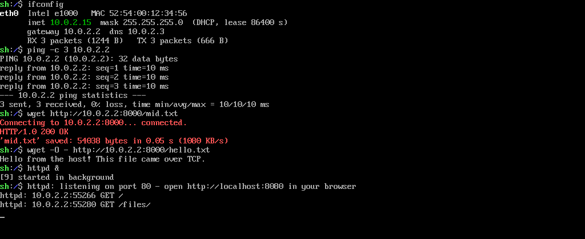

После `httpd &` открой в браузере Windows **http://localhost:8080** — QEMU
пробрасывает порт 8080 твоего компьютера на порт 80 MyOS. Там живая страница с
процессами и сетью (обновляется каждые 3 секунды) и `/files/` — обзор диска MyFS.
Остановить сервер: `ps`, потом `kill <pid>`.

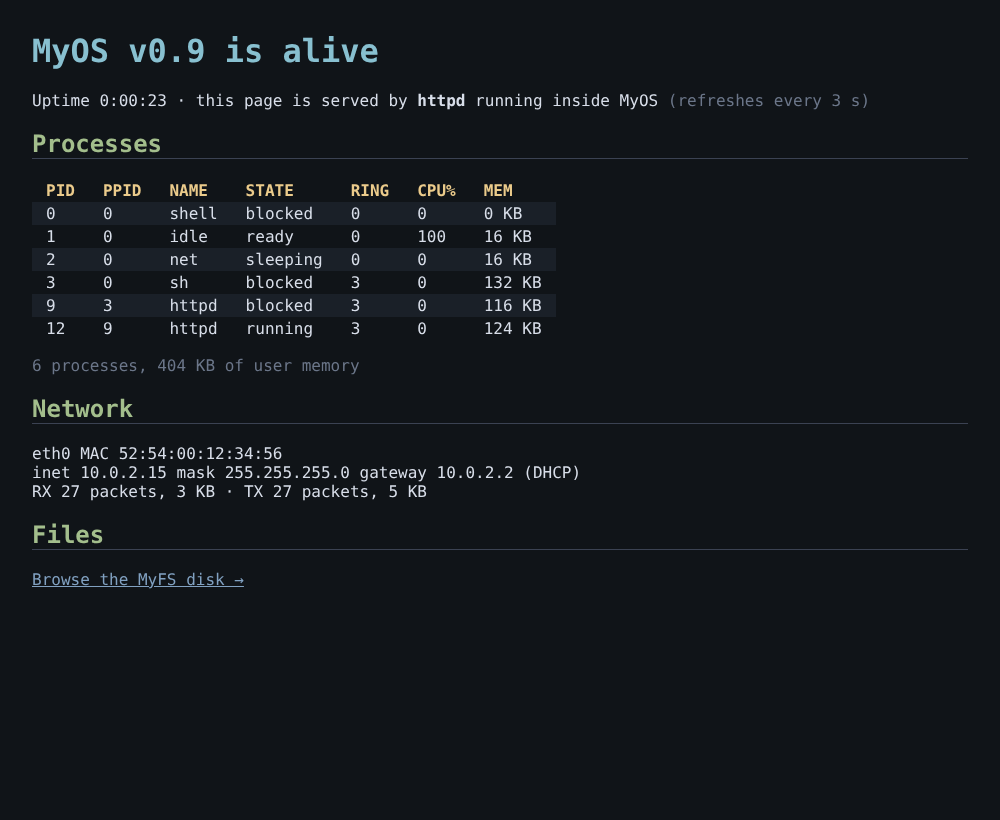

Ограничения:
- **ping во внешний интернет** через NAT QEMU обычно не проходит (ему нужны права
  администратора); `ping 10.0.2.2` и `ping 127.0.0.1` работают всегда.
- **HTTPS** — только TLS 1.3 (почти все современные сайты); серверы, которые умеют
  лишь TLS 1.2, отвечают ошибкой `protocol_version`. Сертификат пока не проверяется.
- Сменить DNS-сервер: `ifconfig dns 1.1.1.1`.

Как устроено:
- `kernel/e1000.c` — карта сама пишет пришедшие кадры в память (DMA) в кольцо
  буферов; поток ядра `net` раз в 10 мс забирает их.
- `kernel/net.c` — Ethernet, ARP (кто владеет этим IP?), IPv4, ICMP, UDP, DHCP.
- `kernel/tcp.c` — TCP: номера байтов, подтверждения, окно, таймер повторной отправки.
- `kernel/socket.c` — сокеты для программ; `read`/`write`/`close` работают как с файлами.
- Новые системные вызовы: `socket`, `connect`, `bind`, `listen`, `accept`, `sendto`,
  `recvfrom`, `netinfo`, `ping`, `netconfig`. DNS-клиент (`resolve`) — прямо в libc.

Своя сетевая программа:

```c
#include "myos.h"
int main(void) {
    int fd = tcp_connect("example.com", 80);     /* DNS + соединение */
    if (fd < 0) { printf("error: %s\n", strerror(-fd)); return 1; }
    dprintf(fd, "GET / HTTP/1.0\r\nHost: example.com\r\n\r\n");
    char buf[512]; int n;
    while ((n = read(fd, buf, sizeof(buf))) > 0) write(STDOUT, buf, n);
    close(fd);
    return 0;
}
```

### HTTPS (TLS 1.3)

`wget https://example.com/` и браузер ходят по HTTPS. Всё написано с нуля в
`user/lib/tls.c` (~1000 строк), без OpenSSL и других библиотек:

| Что | Зачем |
|---|---|
| X25519 (RFC 7748) | общий секрет с сервером: каждый присылает свой открытый ключ |
| SHA-256, HMAC, HKDF | из секрета и хеша всех сообщений выводятся ключи |
| ChaCha20-Poly1305 (RFC 8439) | шифр записей — быстрый на процессоре без AES-инструкций |
| AES-128-GCM | второй шифр, если сервер не умеет ChaCha20 |

Рукопожатие (RFC 8446): мы шлём ClientHello с нашим ключом X25519 и именем сайта (SNI),
сервер отвечает ServerHello со своим ключом — дальше всё зашифровано. Сервер присылает
сертификат и Finished; Finished мы проверяем (значит, сообщения по пути не подменили),
отвечаем своим Finished — и идут данные. Случайные числа — из счётчика тактов
процессора (`rdtsc`), времени и pid, перемешанных SHA-256.

```
sh:/$ wget https://10.0.2.2:4433/big.html
Connecting to 10.0.2.2:4433... connected.
TLS handshake... TLS 1.3, ChaCha20-Poly1305 (certificate not verified)
HTTP/1.0 200 ok
'big.html' saved: 1208903 bytes in 1.49 s (811 KB/s)
```

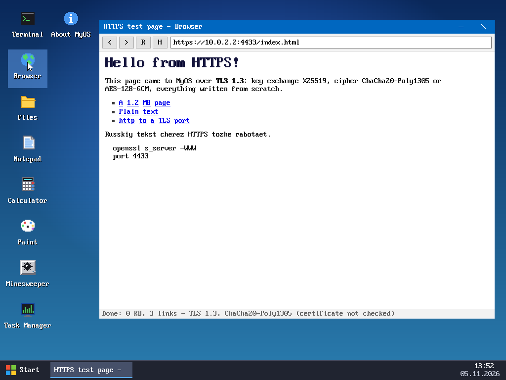

Чего пока нет: **проверки сертификата** (нужны RSA/ECDSA и список корневых центров —
так что канал зашифрован, но поддельный сервер мы не отличим), TLS 1.2, обмена ключами
P-256 (сервер, который не умеет X25519, ответит `handshake_failure`). Проверить у себя:
`openssl s_server -accept 4433 -cert c.pem -key k.pem -WWW` на Windows/WSL и в MyOS
`wget https://10.0.2.2:4433/файл`. Тесты криптографии на известных ответах из RFC:
`make test`.

`tls.c` собирается gcc (там 64-битная арифметика, которой нет в `cc` внутри MyOS)
и подключается только к `browser` и `wget`. Своей программе:
`#include "tls.h"`, `tls_open(fd, host, err, n)`, `tls_read`, `tls_write`, `tls_close`.

### JavaScript

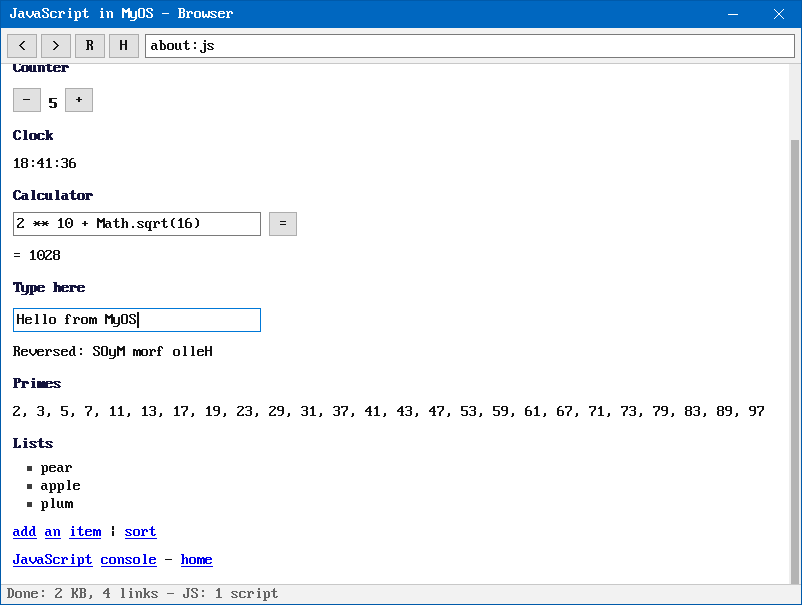

Свой интерпретатор JavaScript, без чужого кода: исходник → токены → дерево (AST) →
обход дерева. Переменным заранее назначаются места в окружении («разрешение имён»),
поэтому при выполнении их не ищут по имени.

| Файл | Что внутри |
|---|---|
| `user/lib/js.c` | значения, строки (интернирование), объекты и свойства, преобразования типов, сборщик мусора |
| `user/lib/jsparse.c` | лексер, парсер, разрешение имён |
| `user/lib/jsrun.c` | выполнение, функции, классы, деструктуризация, генераторы и async (сопрограммы) |
| `user/lib/jslib.c`, `jslib2.c` | Object, Function, Error, Number, Math, Symbol, Proxy, Reflect, Array, String, JSON, Date, Map/Set, Promise, typed arrays |
| `user/lib/jsnum.c` | числа: точная печать `double` (как в браузерах), разбор, математика через x87 |
| `user/lib/jsre.c` | регулярные выражения: компиляция в байт-код и поиск с возвратами |
| `user/lib/dom.c` | дерево документа: разбор HTML, `document.write`, селекторы CSS |
| `user/lib/css.c` | таблицы стилей: разбор, `@media`/`@import`, каскад, `var()`, вычисленный стиль для раскладки и `getComputedStyle` |
| `user/lib/domjs.c`, `dom_prelude.js` | document, элементы, window, события, таймеры, location, cookie, fetch/XMLHttpRequest, localStorage, URL... |

Язык: почти весь ES5 и популярное из ES2015+ — `let`/`const`, стрелочные функции,
классы (поля, `static`, `super`, геттеры), шаблонные строки, деструктуризация,
`...`, `for-of`, генераторы (`function*`, `yield`), `async`/`await`, `?.`, `??`,
`**`, Symbol, Proxy/Reflect, `with`. Нет: модулей (`import`/`export`), async-генераторов,
WebAssembly. Строки хранятся байтами UTF-8, поэтому `length` у кириллицы — в байтах.

Как это работает в браузере: страница разбирается в дерево DOM, скрипты (свои и
внешние `<script src>`) выполняются по ходу разбора. Потом дерево превращается обратно
в простой HTML — его раскладывает прежний код браузера. После щелчков, набора текста,
таймеров и ответов `fetch` раскладка пересчитывается, если скрипты поменяли дерево.
Щелчок по любому тексту отправляет событие `click` его элементу (и выше — так работают
React и Vue). Стили CSS считаются для каждого элемента (`user/lib/css.c`), и раскладка
берёт из них, что умеет показать (см. «Браузер»). Нет картинок, `<canvas>`, точной
раскладки CSS (размеры элементов приблизительные) и WebSocket.

Память — сборщик мусора «пометить и вымести». Он запускается только когда никакой
JS не выполняется (между скриптами, после событий и таймеров), поэтому не нужно следить
за временными значениями. Генераторы и `async`-функции работают на своих стеках
(переключение — несколько команд ассемблера), их стеки сборщик просматривает отдельно.
У программ MyOS стек 64 КБ, поэтому JS выполняется на своём стеке в 2 МБ.

```
sh:/$ js
MyOS JavaScript. Type an expression, empty line or Ctrl+D to quit.
> [1,2,3].map(x => x*x).join('+') + ' ' + (0.1+0.2)
'1+4+9 0.30000000000000004'
> function* nat() { let n = 1; while (true) yield n++; }
> var g = nat(); [g.next().value, g.next().value, g.next().value]
[1, 2, 3]
```

`js файл.js` выполняет файл. Тесты на Linux: `make jstest` — ~200 проверок языка,
генераторы и async, DOM на тестовых страницах (`tests/js`, `tests/web`).
`build/dom-host страница.html` — браузерный DOM без окна, удобно для отладки
(`build/dom-host страница.html styles` — ещё и вычисленные стили элементов с `id`).

## Компилятор cc

`cc` — компилятор языка Си, который работает внутри MyOS. Ему не нужны ни gcc,
ни ассемблер, ни компоновщик: он сам переводит текст в машинный код x86 и сам
записывает исполняемый файл ELF, который ядро запускает как любую программу.

```
sh:/$ cc hi.c                    # -> программа hi в той же папке
sh:/$ cc -o /bin/hi hi.c         # сразу в /bin: теперь это команда hi
sh:/$ cc a.c b.c -o prog         # несколько файлов в одну программу
sh:/$ cc -E hi.c                 # посмотреть текст после препроцессора
sh:/$ time cc /src/snake.c       # time — сколько работала команда
```

Исходники всех программ MyOS лежат на диске в `/src` — любую можно поменять и
пересобрать: `cc /src/snake.c -o mysnake`. Там же исходник самого компилятора:
`cc /src/cc/*.c -o cc2` — и `cc2` умеет то же, что `cc` (собирается за ~1 с).

Что умеет язык (почти весь Си):
- `int`, `char`, `short`, `unsigned`, `_Bool`/`bool`, `float`, `double`, `enum`;
- указатели, массивы (и многомерные), `struct`, `union`, `typedef`, указатели на функции;
- структуры можно присваивать, передавать в функции и возвращать из них;
- `if`, `for`, `while`, `do`, `switch` (и `case 1 ... 5:`), `goto`, `break`, `continue`;
- функции с переменным числом аргументов (`...`, `va_list`);
- препроцессор: `#include`, `#define` с параметрами, `#` и `##`, `#if`/`#ifdef`/`#elif`;
- инициализаторы: `int a[] = {1, 2}`, `struct p q = { .x = 1 }`, строки в массивах.

Чего нет: `long long` (int и long здесь 32 бита), битовых полей, ассемблерных вставок
(для системных вызовов есть `__syscall(номер, a, b, ...)`), составных литералов `(struct p){...}`.

Библиотека — та же, что у программ из WSL: заголовки `/include/myos.h` и
`/include/gfx.h`, а исходники `/lib/libc.c` и `/lib/gfx.c` компилируются вместе с
программой (лишние функции выбрасываются).

Как устроен (`user/cc/`):
- `lex.c` — текст -> токены; `pp.c` — препроцессор (макросы раскрываются на токенах);
- `parse.c` — рекурсивный спуск: токены -> дерево с типами;
- `gen.c` — дерево -> байты x86: результат в `eax` (дробный — в `st(0)` сопроцессора),
  промежуточные значения — в стеке; затем «компоновка» по именам и запись ELF.

Проверка: `make cctest` (в WSL) гоняет тестовые программы из `tests/cc/` и проверяет,
что компилятор, собранный самим собой, собирает себя байт в байт так же.

## Файловая система MyFS

Блок = сектор = 512 байт.

```
блок 0        суперблок: magic "MYFS", размеры и смещения областей
блоки 1..B    битовая карта: 1 бит на блок (0 — свободен)
следующие 32  таблица inode: 256 штук по 64 байта
дальше        блоки данных
```

- **inode**: тип (файл/каталог), размер, 12 прямых ссылок на блоки, одна
  косвенная (блок со 128 ссылками) и одна двойная косвенная (блок со 128 ссылками
  на такие блоки). Максимальный файл: (12 + 128 + 128 × 128) × 512 ≈ 8 МБ.
- **Каталог** — обычный файл из записей по 32 байта `{номер inode, имя до 27 символов}`.
  В каждом каталоге есть `.` и `..`; корень — inode 1.
- Если при загрузке на диске нет ФС (нет magic), ядро форматирует его само.
  Команда `format yes` стирает диск вручную.
- Утилита `build/myfs` (собирается из того же `kernel/fs.c`) работает с `disk.img`
  прямо с компьютера: `build/myfs disk.img ls /bin`, `build/myfs disk.img put file.txt /file.txt`.

## Структура

```
boot/boot.asm      загрузочный сектор
kernel/entry.asm   точка входа ядра, обнуление .bss
kernel/isr.asm     заглушки прерываний, общий обработчик
kernel/idt.c       IDT, PIC, исключения
kernel/timer.c     PIT
kernel/keyboard.c  PS/2 клавиатура
kernel/vga.c       консоль и kprintf
kernel/pmm.c       физический аллокатор страниц, карта E820
kernel/paging.c    страничная адресация
kernel/heap.c      куча ядра: kmalloc / kfree / krealloc
kernel/task.c      задачи, планировщик, сон/ожидание, мьютексы
kernel/demo.c      демо-потоки для spawn
kernel/gdt.c       GDT с сегментами кольца 3 и TSS
kernel/process.c   загрузчик ELF, запуск процессов, Ctrl+C
kernel/syscall.c   системные вызовы int 0x80
kernel/file.c      открытые файлы со счётчиком ссылок, консоль, каналы
kernel/pci.c       чтение конфигурации PCI
kernel/fb.c        видеокарты VMware SVGA II (FIFO, RECT_COPY, курсор) и Bochs VBE, режимы, шрифт
kernel/display.c   смена разрешения целиком (карта, консоль, мышь), /etc/display
kernel/mouse.c     мышь PS/2
kernel/e1000.c     драйвер сетевой карты Intel e1000
kernel/net.c       Ethernet, ARP, IPv4, ICMP, UDP, DHCP, поток net
kernel/tcp.c       TCP
kernel/socket.c    сокеты для программ
kernel/ipc.c       общая память, сообщения, имена служб, часы RTC
user/ifconfig.c ping.c host.c wget.c httpd.c   сетевые программы
user/desktop.c     рабочий стол: окна, панель задач, «Пуск»
user/lib/win.c     библиотека окон для программ (win.h)
user/lib/tls.c     HTTPS: TLS 1.3, X25519, ChaCha20-Poly1305, AES-GCM, SHA-256 (tls.h)
user/browser.c     веб-браузер
user/lib/js*.c     движок JavaScript (js.h); user/js.c — программа js
user/lib/dom*.c    DOM для браузера (dom.h), dom_prelude.js — часть окружения на JS
user/lib/css.c     стили CSS для браузера: каскад и вычисленный стиль
tests/js/ tests/web/  тесты JavaScript, DOM и CSS (make jstest)
user/terminal.c notepad.c files.c calc.c draw.c mines.c taskmgr.c about.c display.c hellowin.c
                   программы для рабочего стола
user/cc/           компилятор Си для MyOS (lex, pp, parse, type, gen, main)
tests/cc/          тесты компилятора (make cctest)
user/lib/          мини-libc для программ: myos.h, libc.c (_start, printf, malloc...)
user/sh.c          оболочка: конвейеры, перенаправления, фон, сценарии, история, Tab, glob
user/edit.c        полноэкранный редактор
user/snake.c       змейка
user/top.c         монитор процессов
user/lib/gfx.c     графическая библиотека для программ
user/mandel.c      фрактал Мандельброта
user/paint.c       рисовалка
user/fputest.c     проверка сохранения FPU
user/*.c           утилиты и программы: ls cat echo grep head wc ps kill mkdir rm sleep yes ...
user/user.ld       раскладка программы: код с 0x40000000
tools/myfs.c       утилита для disk.img на компьютере
kernel/ata.c       драйвер жёсткого диска ATA PIO
kernel/fs.c        файловая система MyFS
kernel/string.c    memset/memcpy/strcmp и т.п.
kernel/shell.c     командная оболочка
kernel/kernel.c    kmain()
tests/fs_test.c    юнит-тесты MyFS (make test)
tests/heap_test.c  юнит-тесты кучи (make test)
linker.ld          ядро линкуется по адресу 0x10000
Makefile
```

## Сборка и запуск (Windows через WSL)

1. Один раз поставь WSL и Ubuntu (PowerShell от администратора):
   `wsl --install`
2. В терминале Ubuntu поставь инструменты:
   ```bash
   sudo apt update
   sudo apt install build-essential nasm qemu-system-x86
   ```
3. Перейди в папку проекта и собери:
   ```bash
   cd /mnt/c/Users/danil/source/myos
   make run        # сборка ядра и программ, установка в /bin, запуск
   make test       # тесты файловой системы и кучи
   make cctest     # тесты компилятора cc (и сборка им самого себя)
   make jstest     # тесты JavaScript, DOM и CSS браузера
   make cleandisk  # стереть disk.img (ФС создастся заново)
   ```

Без WSL можно поставить только QEMU для Windows (qemu.org) и запустить готовые
образы (`disk.img` уже лежит в папке):

```
qemu-system-i386 -m 128M -vga vmware -drive format=raw,file=build\os.img,index=0,media=disk -drive format=raw,file=disk.img,index=1,media=disk -nic user,model=e1000,hostfwd=tcp::8080-:80 -rtc base=localtime
```

Отладка: `make debug` запускает QEMU, ждущий GDB на порту 1234
(`gdb build/kernel.elf -ex "target remote :1234"`).

## Что дальше

1. Рабочий стол дальше: изменение размера окон, кириллица в шрифте, «настоящий»
   терминал (псевдотерминал в ядре).
2. Браузер дальше: картинки (BMP/GIF/PNG), проверка сертификатов HTTPS (RSA, ECDSA,
   корневые центры), закладки, float и колонки CSS, картинки фона; в JS — модули и ускорение (байт-код).
3. Copy-on-write для `fork` (сейчас память копируется сразу целиком).
4. Звук (PC speaker).
5. Загрузка на настоящем компьютере с флешки.
